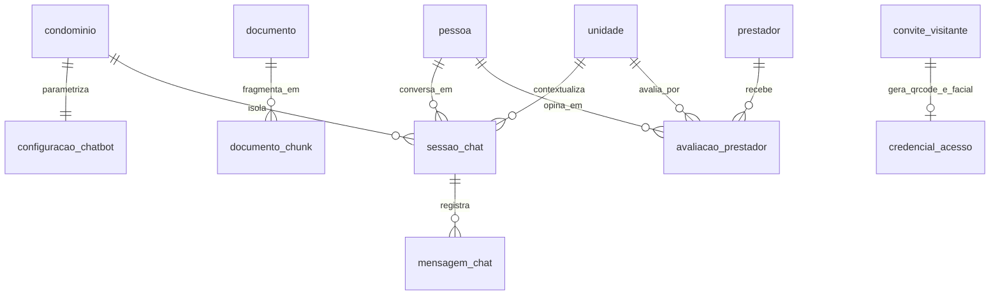

# Agente Conversacional Multicanal (In-App & WhatsApp)

## Problem

Moradores e condôminos enfrentam fricção operacional ao navegar por múltiplos menus, formulários e telas para executar tarefas rotineiras do condomínio: descobrir horários livres de áreas comuns, reservar ou cancelar espaços dentro do prazo regimental, liberar visitantes, hóspedes ou prestadores com biometria facial e QR Code, consultar encomendas retidas na portaria, obter 2ª via de boletos/Pix, abrir ocorrências, buscar prestadores bem avaliados pelos vizinhos ou localizar artigos específicos na Convenção e no Regimento Interno. Do lado da gestão, síndicos e portarias sofrem com atendimento repetitivo de dúvidas normativas e cadastros manuais de acesso na guarita.

Quando esta funcionalidade é entregue, o morador passa a realizar todas essas jornadas completas diretamente por uma interface conversacional guiada por opções numeradas (`1`, `2`, `3`) tanto no aplicativo (PWA Angular) quanto no WhatsApp, respeitando as permissões granulares ativadas pelo síndico, as regras de antecedência/cancelamento do condomínio e a sincronização automática de QR Code e biometria facial com as controladoras de acesso.

## Flow

Reutiliza os serviços de domínio e esquemas dos Bounded Contexts existentes (`condominio`, `identidade_cadastro`, `controle_acesso`, `portaria`, `reservas`, `comunicacao`, `governanca`, `financeiro`) expondo-os como ferramentas determinísticas (Tool Calling) acionadas pelo orquestrador conversacional sob o contexto multi-tenant (`condominio_id`).

1. Mensagem de texto ou seleção numérica entra via PWA ou Webhook WhatsApp -> `FastAPI Auth / Webhook Gateway` (exists) - autentica o token JWT (in-app) ou valida a assinatura HMAC do provedor WhatsApp vinculando o `celular` do remetente a `pessoa` e `ocupacao_unidade` ativa no `condominio_id`
2. `Database Session Dependency` (exists) - injeta a sessão assíncrona com escopo multi-tenant e Row-Level Security (RLS) ativo para o `condominio_id`
3. `Politica Chatbot Guard` (new, door 1) - verifica o entitlement SaaS (`funcionalidade_habilitada(condominio_id, 'agente_conversacional')`) e a matriz granular `configuracao_chatbot` definida pelo síndico para a intenção solicitada
4. `Orquestrador Conversacional Service` (new, door 2) - carrega `sessao_chat` e `opcao_pendente_chat`; se a entrada for um número correspondente a uma opção ativa (`1`, `2`, `3`), resolve deterministicamente o slot sem custo extra de inferência; caso contrário, invoca o adaptador `ProvedorLLM` (new, door 3) com catálogo de tools restrito às capacidades habilitadas pelo síndico
5. `Catalogo Tools Condominiais` (new, door 2) - executa a leitura ou mutação nos módulos de domínio: disponibilidade/reserva/cancelamento até 72h em `reserva` (exists), emissão de link de autocadastro em `convite_visitante` / `autorizacao_prestador` / `ocupacao_unidade` (exists), listagem de pacotes em `encomenda` (exists), 2ª via e Pix em `cobranca_condominial` (exists), abertura de chamado em `ocorrencia` (exists), busca de profissionais por nota média em `avaliacao_prestador` (new, door 5) e busca vetorial RAG em `documento_chunk` via `pgvector` (new, door 4)
6. `Autocadastro e Sincronizacao Facial Handler` (new, door 6) - quando o visitante, hóspede, hóspede temporário ou prestador submete o formulário público do link com selfie e documento, grava o consentimento em `verificacao_facial` (exists), emite `credencial_acesso` (exists) dos tipos `QRCODE` e `FACIAL` e enfileira `sincronizacao_acesso` (exists) para os equipamentos IoT via `AccessControlProvider`
7. out: `MensagemChatResponse` estruturada contendo texto formatado, lista numerada `opcoes` (`1..N` renderizadas como botões no PWA e lista textual no WhatsApp), metadados de anexos (QR Code, Pix copia-e-cola, link de boleto/PDF) e protocolo de auditoria

## Impact

| Front | What changes |
| --- | --- |
| domain | new term: `sessao_chat` - conversa ativa do morador (canal `IN_APP` ou `WHATSAPP`) mantendo estado de diálogo, unidade ativa e histórico auditável |
| domain | new term: `opcao_pendente_chat` - mapa determinístico numerado (`1..N`) associado à sessão que traduz a resposta curta do usuário na execução exata da ação/slot |
| domain | new term: `configuracao_chatbot` - política administrada pelo síndico por condomínio definindo quais capacidades conversacionais estão ativas e o prazo mínimo de cancelamento de reservas |
| domain | new term: `documento_chunk` - fragmento indexado de documentos normativos (Convenção, Regimento Interno, regras de espaços) com vetor de embedding `pgvector` para busca RAG |
| domain | new term: `avaliacao_prestador` - nota de 1 a 5 estrelas e comentário atribuídos por morador a um `prestador` após serviço concluído na unidade, compondo o ranking do condomínio |
| stored data | novas tabelas `configuracao_chatbot`, `sessao_chat`, `mensagem_chat`, `documento_chunk` e `avaliacao_prestador`; extensão PostgreSQL `vector` (`pgvector`) habilitada |

## Relations

One-way constraints: unicidade de `condominio_id` em `configuracao_chatbot` (door 1), chave única de sessão ativa por (`condominio_id`, `pessoa_id`, `canal`) em `sessao_chat` (door 2), índice vetorial HNSW sobre `documento_chunk` filtrado por `condominio_id` (door 4) e constraint única (`condominio_id`, `prestador_id`, `unidade_id`, `avaliador_id`) por atendimento avaliado em `avaliacao_prestador` (door 5).

## Surface

| Route | In | Out | Status |
| --- | --- | --- | --- |
| `POST /api/v1/chat/mensagens` | `texto`, `opcao_selecionada`, `unidade_id`, `anexo_url` | `sessao_id`, `resposta_texto`, `opcoes` · `acoes_executadas`, `cards` | `200`, `400`, `401`, `403`, `422` |
| `GET /api/v1/chat/sessoes/ativa` | `unidade_id` | `sessao_id`, `canal`, `opcoes_pendentes`, `historico` | `200`, `401`, `404` |
| `POST /api/v1/chat/webhooks/whatsapp` | `remetente_celular`, `mensagem_texto`, `message_id`, `assinatura_hmac` | `status_processamento`, `sessao_id`, `resposta_enviada` | `200`, `400`, `401`, `403` |
| `GET /api/v1/chat/configuracoes` | `condominio_id` | `habilitado`, `funcionalidades_ativas`, `prazo_cancelamento_reserva_horas`, `canais_ativos` | `200`, `401`, `403` |
| `PATCH /api/v1/chat/configuracoes` | `habilitado`, `funcionalidades_ativas`, `prazo_cancelamento_reserva_horas`, `canais_ativos` | `configuracao_atualizada` | `200`, `400`, `401`, `403`, `422` |
| `POST /api/v1/chat/documentos/{documento_id}/indexar` | `documento_id` | `documento_id`, `total_chunks`, `status_indexacao` | `200`, `401`, `403`, `404` |
| `GET /api/v1/portaria/autocadastro/{token}` | `token` | `tipo_acesso`, `condominio_nome`, `unidade_identificacao`, `inicio_validade`, `fim_validade`, `exige_facial` | `200`, `400`, `404`, `410` |
| `POST /api/v1/portaria/autocadastro/{token}` | `nome_completo`, `cpf`, `data_nascimento`, `placa_veiculo`, `foto_facial_base64`, `consentimento_lgpd` | `credencial_qrcode`, `status_sincronizacao_facial`, `comprovante_acesso` | `201`, `400`, `404`, `410`, `422` |
| `POST /api/v1/portaria/prestadores/{prestador_id}/avaliacoes` | `nota`, `comentario`, `unidade_id` | `id`, `prestador_id`, `nota_media_atualizada`, `total_avaliacoes` | `201`, `400`, `401`, `403`, `422` |
| `GET /api/v1/portaria/prestadores/ranking` | `atividade`, `nota_minima` | `itens` · `prestador_id`, `nome`, `atividade`, `celular`, `nota_media`, `total_avaliacoes` | `200`, `401` |

## Landing

| One-way door | Literal shape | Alternative rejected |
| --- | --- | --- |
| Door 1: Governança granular de capacidades do chatbot pelo síndico | Tabela `configuracao_chatbot` com `UNIQUE (condominio_id)`, `funcionalidades_ativas JSONB` (`reservas`, `visitantes_autocadastro`, `ocorrencias`, `documentos_rag`, `encomendas`, `boletos`, `prestadores_ranking`) e `prazo_cancelamento_reserva_horas INTEGER NOT NULL DEFAULT 72` | Habilitar todas as tools do agente de forma monolítica; desqualificado porque cada condomínio possui regras operacionais próprias e o síndico precisa ligar/desligar módulos do bot sem intervenção de código |
| Door 2: Resolução determinística de opções numeradas na sessão | Tabela `sessao_chat` com coluna `opcoes_pendentes JSONB` mapeando chaves `"1".."9"` para `{acao, parametros, expira_em}` e constraint `UNIQUE (condominio_id, pessoa_id, canal)` para sessão ativa | Delegar a interpretação de respostas numéricas (`"1"`, `"2"`) exclusivamente ao prompt do LLM; desqualificado por risco de alucinação de IDs, maior latência e custo desnecessário de tokens no WhatsApp e PWA |
| Door 3: Desacoplamento de provedor de IA e Embeddings via Adapter | Protocolo `ProvedorLLM` (`gerar_resposta_com_tools`, `gerar_embedding`) em `backend/app/core/ia_adapter.py` com seleção por configuração (`LLM_PROVIDER`) | Acoplar o SDK de um único fornecedor (ex.: OpenAI ou Gemini) diretamente nas services de negócio; desqualificado porque o provedor de melhor custo/benefício ainda será arbitrado em produção e pode variar por operação |
| Door 4: Busca semântica multi-tenant sobre PostgreSQL `pgvector` | Extensão `CREATE EXTENSION IF NOT EXISTS vector` e tabela `documento_chunk` com coluna `embedding vector(1536)`, `condominio_id UUID NOT NULL`, `artigo_referencia VARCHAR(100)` e RLS por `condominio_id` | Adotar banco vetorial externo dedicado (Pinecone/Weaviate/Qdrant); desqualificado por adicionar infraestrutura extra, custo fixo e quebrar o isolamento transacional RLS já estabelecido no PostgreSQL (ADR-005/ADR-006) |
| Door 5: Ranking comunitário de prestadores vinculados a atendimentos | Tabela `avaliacao_prestador` com `CHECK (nota BETWEEN 1 AND 5)` e vínculo obrigatório com `prestador_id`, `unidade_id` e `avaliador_id` | Permitir avaliações anônimas ou livres sem vínculo com unidade do condomínio; desqualificado por permitir manipulação de nota e spam no catálogo de prestadores recomendados |
| Door 6: Autocadastro unificado com provisionamento duplo QR Code + Facial | Submissão de `/autocadastro/{token}` exige `consentimento_lgpd = true` quando `foto_facial_base64` é enviada, gravando `verificacao_facial`, criando `credencial_acesso` (`QRCODE` e `FACIAL`) e inserindo registro idempotente em `sincronizacao_acesso` | Gerar apenas QR Code estático no autocadastro; desqualificado porque os condomínios contam com leitoras de reconhecimento facial integradas via `AccessControlProvider` (ADR-004) para visitantes, hóspedes e prestadores |

- Nothing else in this change is hard to reverse

## Criteria

### S1: Governança de Permissões do Chatbot pelo Síndico e Motor de Opções Numeradas (P1)

O síndico configura quais ações o chatbot pode executar no condomínio, e o morador interage por texto livre ou opções numeradas (`1..N`) no PWA e no WhatsApp.

**Acceptance Criteria**

1. WHEN o síndico atualiza `PATCH /api/v1/chat/configuracoes` definindo `funcionalidades_ativas` e `prazo_cancelamento_reserva_horas` THEN the system SHALL persistir a configuração do condomínio e retornar status 200.
2. IF o módulo `agente_conversacional` não estiver habilitado no plano/entitlement do condomínio (`funcionalidade_habilitada = false`) THEN the system SHALL rejeitar requisições a `/api/v1/chat/*` com status 403 e código `FEATURE_DISABLED`.
3. IF o morador solicitar no chat uma funcionalidade desativada pelo síndico em `configuracao_chatbot.funcionalidades_ativas` THEN the system SHALL informar que a funcionalidade não está habilitada para atendimento via chat neste condomínio e retornar status 200 sem executar a tool.
4. WHEN o agente conversacional retornar escolhas ao usuário em `POST /api/v1/chat/mensagens` ou `POST /api/v1/chat/webhooks/whatsapp` THEN the system SHALL numerar cada opção sequencialmente a partir de `1` e persistir o mapeamento correspondente em `sessao_chat.opcoes_pendentes`.
5. WHEN o usuário responder com o identificador numérico de uma opção ativa (ex.: `"1"` ou `"2"`) THEN the system SHALL resolver deterministicamente os parâmetros da opção selecionada em `sessao_chat.opcoes_pendentes` e avançar o fluxo retornando status 200.
6. IF uma mensagem chegar em `POST /api/v1/chat/webhooks/whatsapp` com assinatura HMAC inválida ou telefone não vinculado a morador ativo THEN the system SHALL rejeitar com status 401 ou 403 sem abrir sessão.

**Independent test:** Desativar a funcionalidade `ocorrencias` via `PATCH /api/v1/chat/configuracoes`, tentar abrir ocorrência no chat e constatar bloqueio amigável; reativar e testar seleção de opção `"1"`.

### S2: Reserva e Cancelamento de Espaços via Chat com Regra de Antecedência (P1)

O morador consulta horários disponíveis de uma área comum para uma data, seleciona a opção desejada para reservar após aceitar regras/taxa, ou cancela reservas vigentes respeitando a antecedência mínima (ex.: 72h).

**Acceptance Criteria**

7. WHEN o morador solicita reservar uma área comum informando espaço e data (ex.: `"reservar espaço cinema para 14/10"`) THEN the system SHALL retornar o valor da taxa, resumo das regras e a lista numerada de horários disponíveis naquela data com status 200.
8. WHEN o morador seleciona a opção numérica de um horário disponível e confirma o aceite das regras THEN the system SHALL criar o registro em `reserva` com `status = 'CONFIRMADA'` (ou `'SOLICITADA'` se `requer_aprovacao = true`) e retornar o protocolo com status 200.
9. IF outro morador já tiver reservado o mesmo slot entre a listagem de opções e a confirmação THEN the system SHALL impedir a sobreposição de horário e retornar novas opções disponíveis para a data com status 200.
10. WHEN o morador solicita cancelar uma reserva própria pelo chat com antecedência igual ou superior a `prazo_cancelamento_reserva_horas` (padrão 72 horas antes de `inicio_em`) THEN the system SHALL atualizar `reserva.status` para `'CANCELADA'` e confirmar o cancelamento com status 200.
11. IF o morador tentar cancelar uma reserva pelo chat faltando menos horas que `prazo_cancelamento_reserva_horas` para o `inicio_em` THEN the system SHALL negar o cancelamento informando o prazo mínimo exigido pelo condomínio e manter a reserva ativa com status 200.

**Independent test:** Solicitar reserva do Cinema para 14/10 no chat, receber opções `1: 10:00 às 12:00` e `2: 13:00 às 14:00`, responder `1`, confirmar reserva; em seguida testar cancelamento com >72h (sucesso) e com <72h (bloqueado pela regra).

### S3: Autocadastro de Visitantes, Hóspedes e Prestadores com QR Code e Biometria Facial (P1)

O morador gera pelo chat um link de autocadastro ou convite direto para visitante, hóspede, hóspede temporário ou prestador, habilitando entrada por QR Code e reconhecimento facial nos equipamentos de acesso.

**Acceptance Criteria**

12. WHEN o morador solicita liberar acesso no chat THEN the system SHALL oferecer opções numeradas para o perfil de entrada (`1: Visitante`, `2: Hóspede`, `3: Hóspede Temporário`, `4: Prestador de Serviço`) e o modo (`1: Gerar Link de Autocadastro`, `2: Cadastrar Dados Agora`) com status 200.
13. WHEN o morador confirma a geração de link de autocadastro THEN the system SHALL gerar um token criptográfico com validade restrita ao período informado e retornar a URL pública `/autocadastro/{token}` no chat com status 200.
14. WHEN o convidado, hóspede ou prestador submete dados válidos, foto facial e `consentimento_lgpd = true` em `POST /api/v1/portaria/autocadastro/{token}` THEN the system SHALL registrar a pessoa/vínculo correspondente, emitir `credencial_acesso` dos tipos `QRCODE` e `FACIAL`, enfileirar `sincronizacao_acesso` para o hardware de controle de acesso e retornar status 201.
15. IF o token de autocadastro estiver expirado, cancelado ou já utilizado em `GET` ou `POST /api/v1/portaria/autocadastro/{token}` THEN the system SHALL rejeitar a operação com status 410 e código `CONVITE_EXPIRADO_OU_UTILIZADO`.

**Independent test:** Gerar link de autocadastro para visitante via chat, submeter `POST /api/v1/portaria/autocadastro/{token}` com selfie base64 e consentimento LGPD, e verificar criação de `credencial_acesso` (`QRCODE` e `FACIAL`) e item pendente em `sincronizacao_acesso`.

### S4: Consulta de Documentos Normativos e Regras via RAG com `pgvector` (P2)

O morador tira dúvidas em linguagem natural sobre Convenção, Regimento Interno, regras de espaços e taxas, recebendo respostas fundamentadas com citação do documento.

**Acceptance Criteria**

16. WHEN o administrador solicita indexação em `POST /api/v1/chat/documentos/{documento_id}/indexar` THEN the system SHALL segmentar o texto do documento, gerar embeddings via `ProvedorLLM`, persistir os vetores em `documento_chunk` com `condominio_id` e retornar status 200 com `total_chunks`.
17. WHEN o morador envia pergunta normativa no chat (ex.: `"qual o horário de silêncio?"` ou `"qual a regra e taxa da churrasqueira?"`) THEN the system SHALL consultar `documento_chunk` por similaridade de cosseno no `pgvector` restrita ao `condominio_id` combinada aos parâmetros de `area_comum` e responder citando o nome do documento ou artigo com status 200.
18. IF nenhum trecho com similaridade mínima configurada for encontrado no acervo do condomínio THEN the system SHALL informar que a norma específica não consta nos documentos indexados do condomínio e oferecer opção de encaminhar mensagem à administração com status 200.

**Independent test:** Indexar um Regimento Interno de teste, perguntar no chat sobre horário de mudança e verificar resposta contendo a regra exata e a referência ao documento.

### S5: Abertura de Ocorrências, Encomendas, Boletos e Ranking de Prestadores (P2)

O morador abre ocorrências pelo chat, consulta pacotes pendentes de retirada na portaria, obtém 2ª via de boletos/Pix e pesquisa/avalia prestadores cadastrados com ranking dos moradores.

**Acceptance Criteria**

19. WHEN o morador relata um problema no chat e confirma a opção de abertura de ocorrência THEN the system SHALL criar o registro na tabela `ocorrencia` com `origem = 'MORADOR'` e retornar o protocolo gerado com status 200.
20. WHEN o morador consulta suas encomendas pelo chat THEN the system SHALL listar os registros da sua `unidade_id` em `encomenda` com `status = 'RECEBIDA'`, exibindo transportadora, data de recebimento e `codigo_retirada` com status 200.
21. WHEN o morador solicita boletos ou Pix pelo chat THEN the system SHALL consultar `cobranca_condominial` da sua `unidade_id` com `status IN ('PENDENTE', 'VENCIDO')` e retornar vencimento, valor total, `linha_digitavel` e `codigo_pix` com status 200.
22. WHEN o morador avalia um profissional em `POST /api/v1/portaria/prestadores/{prestador_id}/avaliacoes` ou via opção no chat com nota entre 1 e 5 THEN the system SHALL persistir a avaliação em `avaliacao_prestador` e retornar a `nota_media_atualizada` com status 201.
23. WHEN o morador consulta indicação de prestadores no chat ou em `GET /api/v1/portaria/prestadores/ranking` informando a atividade THEN the system SHALL retornar os prestadores ativos ordenados de forma decrescente pela `nota_media` e `total_avaliacoes` dos moradores com status 200.

**Independent test:** Consultar encomendas pendentes, consultar boleto em aberto com Pix copia-e-cola, cadastrar avaliação nota 5 para um prestador eletricista e consultar ranking no chat verificando ordenação pela nota.

## Out of scope

| Excluded | Why |
| --- | --- |
| Atendimento por chamadas de voz telefônica (URA/VoIP) | O escopo conversacional abrange texto e mídia em chat In-App e WhatsApp |
| Pagamento com cartão de crédito dentro da janela do chat | O chat entrega `linha_digitavel` e `codigo_pix` de `cobranca_condominial`; liquidação ocorre no banco/gateway financeiro |
| Negociação jurídica automatizada de inadimplência pelo bot | Acordos seguem regras formais do Bounded Context `08_financeiro` (`termo_acordo`) |

## Assumptions

| Assumption | Chosen default | Rationale | Confirmed? |
| --- | --- | --- | --- |
| Canal conversacional suportado | Híbrido In-App (PWA Angular) + Webhook WhatsApp usando o mesmo motor de opções numeradas (`1..N`) | Permite experiência fluida tanto no app quanto no WhatsApp sem duplicar regras de negócio | y |
| Mecanismo de busca vetorial RAG | Extensão `pgvector` nativa no PostgreSQL com isolamento RLS por `condominio_id` | Aproveita a infraestrutura PostgreSQL existente sem custo de banco vetorial externo | y |
| Escolha do provedor de LLM / Embeddings | Interface agnóstica `ProvedorLLM` (Adapter Pattern) configurável por variável de ambiente | Provedor de melhor custo-benefício será definido/ajustado sem impacto nos módulos de domínio | y |
| Prazo padrão para cancelamento de reserva via chat | 72 horas antes de `inicio_em`, parametrizável pelo síndico em `configuracao_chatbot` | Atende à regra padrão informada pelo usuário mantendo flexibilidade por condomínio | y |
| Acesso biométrico para visitantes, hóspedes e prestadores | Autocadastro coleta selfie com consentimento LGPD e provisiona tanto QR Code quanto sincronização facial IoT | Alinhado à integração de equipamentos de controle de acesso facial (ADR-004) | y |

**Open questions:** none - all product, channel, cancellation, governance and facial access rules confirmed with user.

## Observable

| Surface | Decision | Landing |
| --- | --- | --- |
| screen `chat-assistente` | empty state com sugestões de comandos rápidos, loading indicator de digitação, erro de rede e chips clicáveis para opções `1..N` | AC 4, AC 5 |
| screen `chat-configuracoes-sindico` | toggles de funcionalidades permitidas no chatbot e input numérico de prazo de cancelamento (72h) | AC 1, AC 3 |
| screen `autocadastro-externo` | formulário mobile-first para visitante/hóspede/prestador com captura de selfie, termo LGPD, estado de link expirado (410) e exibição do QR Code final | AC 13, AC 14, AC 15 |
| API `POST /api/v1/chat/mensagens` | envelope de resposta com `opcoes` numeradas, cards ricos e código `FEATURE_DISABLED` (403) quando módulo inativo | AC 2, AC 4, AC 5 |
| API `POST /api/v1/chat/webhooks/whatsapp` | validação de assinatura HMAC, vínculo por celular do morador e idempotência por `message_id` | AC 4, AC 6 |
| API `PATCH /api/v1/chat/configuracoes` | restrito a perfil `SINDICO` ou `ADMINISTRADOR` do condomínio ativo | AC 1 |
| API `POST /api/v1/portaria/autocadastro/{token}` | validação de vigência do token (410 se expirado/usado) e disparo de sincronização facial + QR Code | AC 14, AC 15 |
| API `GET /api/v1/portaria/prestadores/ranking` e `POST .../avaliacoes` | ordenação decrescente por `nota_media` e validação de nota entre 1 e 5 | AC 22, AC 23 |
| all new `/api/v1/chat/*` | versionamento `/api/v1/` e isolamento multi-tenant via RLS `condominio_id` | existing - fundação Marco 0 e ADR-006 |

## Sources

- `docs/decisoes/ADR-004-integracao-intelbras-facial.md` - pré-cadastro com reconhecimento facial via `AccessControlProvider` e fallback QR Code
- `docs/decisoes/ADR-006-isolamento-rls-postgresql.md` - isolamento multi-tenant por `condominio_id`
- `docs/decisoes/ADR-009-idempotencia-integracoes.md` - fila de sincronização idempotente para equipamentos de controle de acesso
- `docs/decisoes/ADR-011-planos-e-funcionalidades.md` - verificação de entitlement SaaS via `funcionalidade_habilitada`
- `docs/sql/004-controle-acesso.sql` - tabelas `credencial_acesso`, `autorizacao_acesso` e `sincronizacao_acesso`
- `docs/sql/005-portaria.sql` - tabelas `visitante`, `convite_visitante`, `prestador`, `autorizacao_prestador` e `encomenda`
- `docs/sql/006-reservas.sql` - tabela `reserva`
- `docs/sql/007-comunicacao.sql` - tabela `ocorrencia`
- `docs/sql/008-governanca.sql` - tabela `documento`
- `docs/sql/009-financeiro.sql` - tabela `cobranca_condominial`
