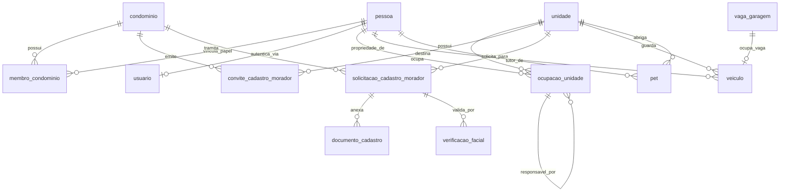

# Bounded Context 01: Identidade e Cadastro (Completo)

## Problem

A gestão de acesso em condomínios sofre com dados cadastrais desatualizados, cadastros informais em planilhas sem separação de dados civis e credenciais de login, descontrole de veículos nas garagens e animais de estimação sem identificação. Além disso, conflitos jurídicos frequentes de posse direta (proprietários locadores mantendo acesso irrestrito às áreas privativas no lugar de inquilinos), dependentes órfãos cadastrados sem responsável morador e estadias temporárias sem prazo de expiração colocam em risco a segurança física e a conformidade com a LGPD.

Com a entrega unificada do Bounded Context `01_identidade_cadastro`, o condomínio passa a operar com um motor canônico completo de identificação civil e digital: pessoas físicas com dados protegidos (CPF com hash determinístico e criptografia reversível), contas de usuário isoladas de dados civis ([ADR-008](../../../docs/decisoes/ADR-008-pessoa-e-usuario.md)), gestão formal de ocupações com aplicação estrita das 5 regras invariantes de posse direta e prazos, auto-onboarding com envio e validação de documentos probatórios e biometria facial, e controle integrado de veículos (placas/vagas) e animais domésticos.

## Flow

Este fluxo conecta os 4 submódulos canônicos de `backend/app/modules/identidade_cadastro/` (`pessoas/`, `usuarios/`, `onboarding/` e `veiculos_pets/`) ao banco relacional multi-tenant e aos componentes Angular Standalone em `frontend/src/app/features/identidade_cadastro/`:

1. Requisição HTTP entra -> `FastAPI Auth Middleware` (exists) - extrai credenciais, claims de tenant (`condominio_id`) e validação de token JWT
2. `Database Session Dependency` (exists) - injeta contexto de tenant ativo para aplicação de RLS no PostgreSQL
3. `Pessoas Service` (exists) - gerencia dados civis em `pessoa`, garantindo isolamento LGPD e busca rápida via `cpf_hash`
4. `Usuarios e Ocupacoes Service` (exists) - controla credenciais de acesso em `usuario`, papéis em `membro_condominio` e vínculos habitacionais em `ocupacao_unidade` aplicando as 5 regras invariantes
5. `Onboarding Service` (exists) - orquestra geração de convites em `convite_cadastro_morador`, tramitação em `solicitacao_cadastro_morador`, conferência de arquivos em `documento_cadastro` e validação preliminar em `verificacao_facial`
6. `Veiculos e Pets Service` (exists) - valida formato de placa Mercosul/tradicional e vinculação de garagem em `veiculo`, e dados biométricos/vacinais em `pet`
7. `Rotina de Expiracao CLI` (exists) - varredura diária via `rotina_expiracao_ocupacoes.py` inativando vínculos vencidos e propagando cascade para dependentes
8. out: `JSON Response` tipada via esquemas Pydantic v2 com status HTTP explícito, consumida pelo PWA Angular com Signals

## Impact

| Front | What changes |
| --- | --- |
| domain | new term: `ocupacao_unidade` - vínculo jurídico formal de uma pessoa com uma unidade física, contendo tipo de vínculo, vigência e indicador de residência local |
| domain | new term: `solicitacao_cadastro_morador` - fluxo transacional de aprovação de novos residentes com validação documental e prova de vida facial |
| domain | new term: `veiculo` - automóvel ou moto vinculado à unidade habitacional e à vaga de garagem demarcada |
| domain | new term: `pet` - animal doméstico registrado para controle de segurança e identificação nas áreas comuns |
| stored data | tabelas `pessoa`, `usuario`, `membro_condominio`, `ocupacao_unidade`, `convite_cadastro_morador`, `solicitacao_cadastro_morador`, `documento_cadastro`, `verificacao_facial`, `veiculo` e `pet` ativas no banco relacional |

## Relations

One-way constraints: combinação (`condominio_id`, `placa`) estritamente única em `veiculo`, chave estrangeira auto-referencial `responsavel_ocupacao_id` em `ocupacao_unidade`, e constraints de datas `ck_ocupacao_curto_prazo_datas` e `ck_ocupacao_fim_maior_inicio` em `ocupacao_unidade`.

## Surface

| Route | In | Out | Status |
| --- | --- | --- | --- |
| `POST /api/v1/identidade/pessoas` | `nome_completo`, `cpf`, `email`, `celular`, `data_nascimento` | `id`, `nome_completo`, `email`, `status` | `201`, `400`, `422` |
| `GET /api/v1/identidade/pessoas` | `busca`, `pagina`, `limite` | `itens`, `total`, `pagina` | `200`, `401` |
| `GET /api/v1/identidade/pessoas/me` | `nenhum` | `id`, `nome_completo`, `email`, `unidades` | `200`, `401`, `404` |
| `POST /api/v1/identidade/usuarios/registrar` | `email`, `senha`, `pessoa_id`, `nome_completo` | `id`, `email`, `ativo` | `201`, `400`, `422` |
| `POST /api/v1/identidade/usuarios/login` | `email`, `senha` | `access_token`, `token_type` | `200`, `401`, `422` |
| `GET /api/v1/identidade/ocupacoes` | `unidade_id`, `condominio_id`, `apenas_ativas` | `lista_ocupacoes` | `200`, `401` |
| `POST /api/v1/identidade/ocupacoes` | `condominio_id`, `unidade_id`, `pessoa_id`, `tipo_vinculo`, `mora_no_local`, `inicio_em`, `fim_em`, `responsavel_ocupacao_id` | `id`, `tipo_vinculo`, `mora_no_local`, `status` | `201`, `400`, `422` |
| `GET /api/v1/identidade/ocupacoes/{id}` | `id` | `detalhes_ocupacao` | `200`, `401`, `404` |
| `PATCH /api/v1/identidade/ocupacoes/{id}` | `id`, `mora_no_local`, `fim_em`, `tipo_vinculo` | `detalhes_ocupacao` | `200`, `400`, `404`, `422` |
| `POST /api/v1/identidade/ocupacoes/{id}/inativar` | `id`, `cascade_dependentes`, `novo_responsavel_ocupacao_id` | `ocupacao_id`, `status`, `dependentes_inativados` | `200`, `404`, `422` |
| `POST /api/v1/identidade/ocupacoes/rotina-expiracao` | `condominio_id` | `ocupacoes_inativadas`, `dependentes_inativados` | `200`, `401` |
| `POST /api/v1/identidade/convites` | `unidade_id`, `nome_completo`, `email`, `tipo_vinculo` | `convite_id`, `token`, `expira_em` | `201`, `400`, `403`, `422` |
| `POST /api/v1/identidade/convites/{token}/aceitar` | `token` | `status`, `unidade_id`, `tipo_vinculo` | `200`, `400`, `404` |
| `POST /api/v1/identidade/onboarding/solicitar` | `unidade_id`, `nome_completo`, `email`, `celular`, `tipo_vinculo` | `solicitacao_id`, `status`, `criada_em` | `201`, `400`, `422` |
| `GET /api/v1/identidade/onboarding/solicitacoes` | `status`, `condominio_id` | `lista_solicitacoes` | `200`, `401`, `403` |
| `POST /api/v1/identidade/onboarding/solicitacoes/{id}/aprovar` | `id`, `observacao` | `solicitacao_id`, `status`, `aprovado_em` | `200`, `400`, `403`, `404` |
| `POST /api/v1/identidade/onboarding/solicitacoes/{id}/rejeitar` | `id`, `motivo_rejeicao` | `solicitacao_id`, `status`, `rejeitado_em` | `200`, `400`, `403`, `404` |
| `POST /api/v1/identidade/veiculos-pets/veiculos` | `condominio_id`, `unidade_id`, `placa`, `tipo`, `marca`, `modelo`, `cor`, `vaga_garagem_id` | `id`, `placa`, `unidade_id`, `status` | `201`, `400`, `403`, `422` |
| `GET /api/v1/identidade/veiculos-pets/veiculos` | `unidade_id`, `placa`, `condominio_id` | `lista_veiculos` | `200`, `401` |
| `POST /api/v1/identidade/veiculos-pets/pets` | `condominio_id`, `unidade_id`, `nome`, `especie`, `raca`, `porte`, `vacinado` | `id`, `nome`, `especie`, `status` | `201`, `400`, `403`, `422` |
| `GET /api/v1/identidade/veiculos-pets/pets` | `unidade_id`, `condominio_id` | `lista_pets` | `200`, `401` |

## Landing

| One-way door | Literal shape | Alternative rejected |
| --- | --- | --- |
| Separação estrita Pessoa vs Usuário | Tabela `pessoa` com dados civis LGPD distinta de `usuario` com credenciais | Mesclar dados civis em `usuario`; desqualificado por impedir o cadastro de dependentes menores de idade e violar o ADR-008 |
| Transmissão de posse direta proprietário vs inquilino | Se `INQUILINO` ativo na unidade, `PROPRIETARIO` tem `mora_no_local` alterado automaticamente para `false`; novas tentativas de marcar proprietário como morador são rejeitadas com erro 400 | Permitir coexistência de posse direta simultânea; desqualificado por violar os arts. 1.196 e 1.197 do Código Civil e a Lei 8.245/1991 |
| Vínculo obrigatório de dependente com morador residente | Coluna `responsavel_ocupacao_id UUID REFERENCES ocupacao_unidade(id)` e cascade para `INATIVO` na saída do inquilino | Deixar dependentes sem vínculo com o titular; desqualificado por permitir permanência indevida de terceiros após término de locação |
| Unicidade condominial de placas de veículos | Constraint `UNIQUE (condominio_id, placa)` na tabela `veiculo` | Permitir placas duplicadas em unidades distintas; desqualificado por impedir acurácia na integração com leitoras LPR |

- Nothing else in this change is hard to reverse

## Criteria

### S1: Gestão Civil de Pessoas e Separação de Contas de Acesso (P1)

Cadastro civil completo com proteção LGPD e credenciais de login desacopladas.

**Acceptance Criteria**

1. WHEN um usuário autenticado envia dados válidos para `POST /api/v1/identidade/pessoas` THEN the system SHALL criar o registro civil em `pessoa` e retornar status 201 com o ID gerado.
2. WHEN uma nova conta de usuário é criada em `POST /api/v1/identidade/usuarios/registrar` THEN the system SHALL associar opcionalmente o `pessoa_id` e gerar o hash bcrypt da senha retornando status 201.
3. IF houver tentativa de cadastrar um usuário com e-mail já existente THEN the system SHALL rejeitar a criação com status 400 e detalhe `Email já cadastrado`.
4. The system SHALL permitir a existência de pessoas físicas ativas sem credencial de autenticação correspondente na tabela `usuario`.

**Independent test:** Cadastrar pessoa civil sem conta, registrar conta com credenciais válidas e constatar que tentativa com e-mail duplicado retorna 400.

### S2: Regras Invariantes de Ocupação da Unidade e Posse Direta (P1)

Ciclo de vida habitacional com aplicação das 5 regras invariantes de negócio.

**Acceptance Criteria**

5. WHEN uma ocupação de `PROPRIETARIO` é submetida com `mora_no_local = true` em unidade que já possui `INQUILINO` ativo THEN the system SHALL rejeitar a operação com status 400 e código `CONFLITO_POSSE_DIRETA`.
6. WHEN uma ocupação de `INQUILINO` é ativada em unidade com proprietário morador THEN the system SHALL alterar automaticamente o campo `mora_no_local` do proprietário para `false`.
7. IF um vínculo do tipo `TEMPORARIO` ou `HOSPEDE` for submetido sem preenchimento de `inicio_em` ou `fim_em` THEN the system SHALL rejeitar a criação com status 400 ou 422 e código `DATAS_OBRIGATORIAS_CURTO_PRAZO`.
8. IF a data de término for anterior ou igual à data de início (`fim_em <= inicio_em`) THEN the system SHALL rejeitar a operação com status 400 ou 422 e código `DATA_FIM_DEVE_SER_MAIOR_QUE_INICIO`.
9. WHEN a rotina diária de expiração é disparada via `POST /api/v1/identidade/ocupacoes/rotina-expiracao` THEN the system SHALL alterar o status para `INATIVO` de todas as ocupações com `fim_em < now()`.
10. IF um vínculo do tipo `DEPENDENTE` for cadastrado em unidade sem nenhum proprietário morador ou inquilino ativo residente THEN the system SHALL rejeitar a criação com status 400 e código `DEPENDENTE_SEM_RESPONSAVEL_RESIDENTE`.
11. WHEN um inquilino responsável é inativado através de `POST /api/v1/identidade/ocupacoes/{id}/inativar` THEN the system SHALL inativar automaticamente em cascata todos os dependentes a ele vinculados.

**Independent test:** Executar suíte `test_ocupacao_unidade.py` comprovando aprovação de todas as 5 regras de posse e cascade.

### S3: Fluxo de Convites e Auto-Onboarding com Validação Documental (P2)

Entrada de moradores via convite temporário ou solicitação pública com upload de documentos.

**Acceptance Criteria**

12. WHEN um morador titular gera um convite em `POST /api/v1/identidade/convites` THEN the system SHALL gerar um token seguro com validade estrita de 7 dias e retornar status 201.
13. IF o aceite de um convite for executado após a data de expiração (`validade_em < now()`) THEN the system SHALL rejeitar o ingresso com status 400 e código `CONVITE_EXPIRADO`.
14. WHEN um futuro morador submete uma solicitação de ingresso em `POST /api/v1/identidade/onboarding/solicitar` THEN the system SHALL criar a solicitação com status inicial `RASCUNHO` ou `ENVIADA`.
15. WHEN a gestão aprova a solicitação em `POST /api/v1/identidade/onboarding/solicitacoes/{id}/aprovar` THEN the system SHALL criar automaticamente o vínculo em `ocupacao_unidade` e o registro em `membro_condominio`.
16. IF a gestão rejeitar a solicitação em `POST /api/v1/identidade/onboarding/solicitacoes/{id}/rejeitar` sem fornecer a justificativa THEN the system SHALL rejeitar a requisição com status 400 ou 422.

**Independent test:** Gerar convite, simular expiração e comprovar bloqueio; criar solicitação de auto-onboarding e aprovar como síndico gerando a ocupação.

### S4: Cadastro e Controle de Veículos e Vagas de Garagem (P2)

Identificação de automóveis e motocicletas para liberação de acesso e prevenção de conflitos de estacionamento.

**Acceptance Criteria**

17. WHEN o morador ou gestor cadastra um automóvel em `POST /api/v1/identidade/veiculos-pets/veiculos` THEN the system SHALL gravar a placa padronizada em maiúsculas e retornar status 201.
18. IF houver tentativa de cadastrar a mesma placa veicular para mais de uma unidade no mesmo condomínio THEN the system SHALL rejeitar a duplicação com status 400.
19. WHEN um veículo é consultado pela placa via `GET /api/v1/identidade/veiculos-pets/veiculos` THEN the system SHALL retornar a unidade e o proprietário correspondente com status 200.

**Independent test:** Cadastrar automóvel na unidade 101, tentar cadastrar a mesma placa na unidade 102 e verificar rejeição por constraint de unicidade.

### S5: Registro de Animais Domésticos e Segurança Coletiva (P3)

Cadastro de pets para controle sanitário, convivência e apoio em casos de fuga.

**Acceptance Criteria**

20. WHEN um morador registra um animal doméstico em `POST /api/v1/identidade/veiculos-pets/pets` THEN the system SHALL persistir o registro com dados de espécie, porte e status de vacinação retornando status 201.
21. WHEN um porteiro ou morador consulta os pets da unidade via `GET /api/v1/identidade/veiculos-pets/pets` THEN the system SHALL retornar a lista de animais ativos com status 200.

**Independent test:** Cadastrar cão de grande porte na unidade 201 e recuperar a ficha do animal com status 200.

## Out of scope

| Excluded | Why |
| --- | --- |
| Reconhecimento facial ao vivo em catracas IoT | Pertence ao Bounded Context `03_controle_acesso` (Fase BC-03) |
| Autorização presencial de visitantes e prestadores na portaria | Pertence ao Bounded Context `04_portaria` (Fase BC-04) |
| Cobrança de taxa condominial por veículo ou pet | Pertence ao Bounded Context `08_financeiro` (Fase BC-08) |

## Assumptions

| Assumption | Chosen default | Rationale | Confirmed? |
| --- | --- | --- | --- |
| Padrão de expiração de convites de cadastro | 7 dias corridos | Prazo suficiente para o morador preencher os dados sem deixar tokens ativos indefinidamente | y |
| Formato de placas de automóveis | Mercosul e Tradicional sem traço em caixa alta | Padronização determinística para busca e integração LPR | y |
| Responsável de dependente omitido | Busca morador residente ativo da unidade | Praticidade quando a unidade possui um único titular morador | y |

**Open questions:** none - all architectural, multi-tenant and occupation business rules confirmed.

## Observable

| Surface | Decision | Landing |
| --- | --- | --- |
| screen `pessoas-perfil` | empty state, loading e mensagens de dados civis | AC 1 |
| screen `ocupacoes-gestao` | exibição de conflito de posse e botões de inativação | AC 5, AC 6, AC 11 |
| screen `veiculos-pets` | cards com visualização de foto, placa e status vacinal | AC 17, AC 20 |
| screen `onboarding-fila` | fila de aprovação com visualizador de documentos e selfie | AC 15, AC 16 |
| API `POST /api/v1/identidade/ocupacoes` | códigos de erro para conflito de posse e dependente órfão | AC 5, AC 10 |
| API `POST /api/v1/identidade/convites/{token}/aceitar` | erro 400 em caso de convite expirado ou já utilizado | AC 13 |
| API `POST /api/v1/identidade/veiculos-pets/veiculos` | validação de duplicidade de placa no condomínio | AC 18 |
| command `rotina_expiracao_ocupacoes.py` | verbosidade informativa e total de ocupações/dependentes inativados | AC 9 |
| all new `/api/v1/identidade/*` | rate limit e auditoria via middleware transversal | n/a - herdado da fundação BC-00 |

## Sources

- `docs/funcionalidades/01_identidade_cadastro/identidade-cadastro.md` - documento mestre do Bounded Context
- `docs/funcionalidades/01_identidade_cadastro/onboarding-e-conta.md` - especificação de contas e membros
- `docs/funcionalidades/01_identidade_cadastro/cadastro-morador-solicitacao.md` - workflow de onboarding documental
- `docs/funcionalidades/01_identidade_cadastro/veiculos-e-pets.md` - gestão de veículos e animais
- `docs/sql/003-identidade-cadastro.sql` - esquema relacional definitivo e triggers de ocupação
- `docs/decisoes/ADR-008-pessoa-e-usuario.md` - separação entre pessoa e usuário
- `docs/decisoes/ADR-013-organizacao-diretorios.md` - padrão arquitetural de 4 arquivos por submódulo
