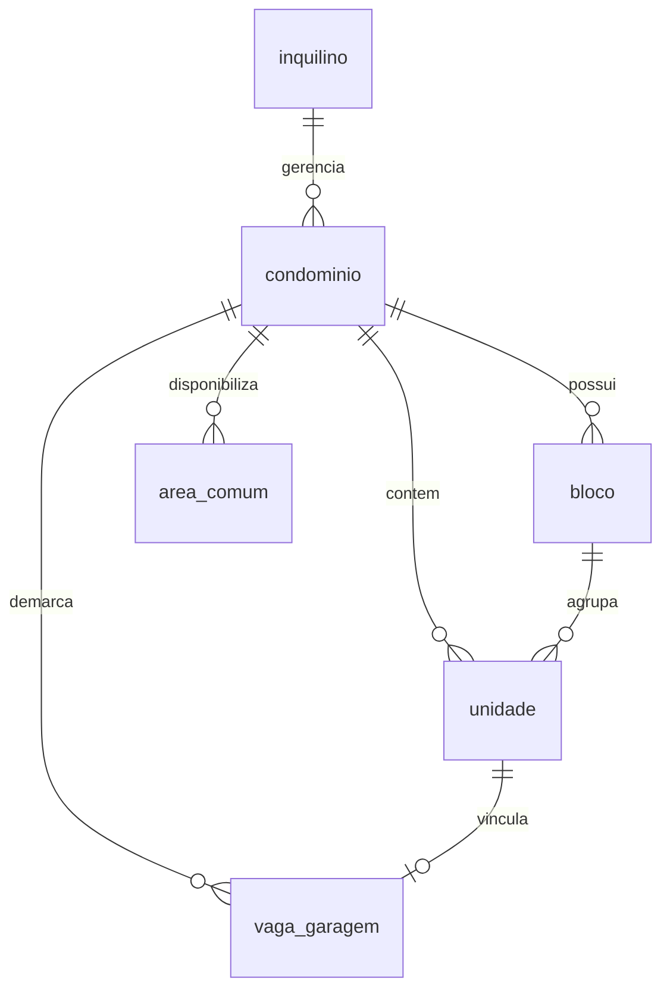

# Bounded Context 02: Condomínio e Estrutura Física (Completo)

## Problem

A gestão predial e habitacional em condomínios sofre quando não há um modelo digital estruturado de sua infraestrutura física. A inexistência de mapeamento hierárquico claro entre blocos/torres, andares, unidades autônomas e vagas de garagem gera desorganização no controle de correspondências, inconsistências no rateio de frações ideais e conflitos de estacionamento. Adicionalmente, áreas de lazer e convivência sem inventário parametrizado (capacidade máxima do AVCB, regras de uso e horários de funcionamento) impedem um agendamento ordenado e seguro, enquanto a falta de identidade institucional (branding, cores e regras operacionais de convivência) enfraquece a comunicação oficial entre síndicos e moradores.

Com a entrega unificada do Bounded Context `02_condominio` como o Segundo Pilar Essencial de Dados, a plataforma estabelece a malha estrutural e física do condomínio: hierarquia completa de blocos e unidades autônomas com suporte a importação em lote via CSV, cadastro e vinculação de vagas de garagem demarcadas, catálogo completo de áreas comuns com gestão de ciclo de vida (ativo/interditado) e parametrização institucional do condomínio com branding e regras de convivência via JSONB auditado ([ADR-011](../../../docs/decisoes/ADR-011-planos-e-funcionalidades.md)).

## Flow

Este fluxo conecta os 2 submódulos canônicos de `backend/app/modules/condominio/` (`estrutura/` e `areas_comuns/`) ao banco relacional multi-tenant e às interfaces Angular PWA:

1. Requisição HTTP entra -> `FastAPI Auth Middleware` (exists) - valida token JWT e extrai o contexto de tenant ativo (`condominio_id`)
2. `Database Session Dependency` (exists) - injeta sessão assíncrona aplicando escopo e RLS PostgreSQL no condomínio ativo
3. `Estrutura Service` (exists) - gerencia divisões prediais em `bloco`, unidades autônomas em `unidade` e vagas de estacionamento em `vaga_garagem`, garantindo unicidade e validação de duplicidade
4. `Importacao CSV Handler` (exists) - processa carga massiva de estrutura física criando blocos e unidades em transação atômica
5. `Areas Comuns Service` (exists) - controla o inventário de espaços compartilhados em `area_comum`, aplicando limites de lotação, faixas de horário e interdições de manutenção
6. `Configuracao Institucional Service` (exists) - gerencia dados cadastrais e parâmetros de branding/regras operacionais em `condominio.configuracoes`
7. out: `JSON Response` tipada via esquemas Pydantic v2 com status HTTP explícito, consumida pelos componentes Angular PWA com Signals

## Impact

| Front | What changes |
| --- | --- |
| domain | new term: `bloco` - divisão física do condomínio (torre, edifício ou quadra) agrupando unidades autônomas |
| domain | new term: `unidade` - fração habitacional ou comercial privativa (apartamento, casa, sala) com identificação e área privativa |
| domain | new term: `vaga_garagem` - espaço de estacionamento demarcado, com tipo e cobertura, vinculado ou autônomo à unidade |
| domain | new term: `area_comum` - espaço compartilhado de lazer e convivência com regras, capacidade e controle de interdição |
| domain | new term: `configuracoes` - objeto JSONB em `condominio` com diretrizes de branding, contato institucional e horários operacionais |
| stored data | tabelas `condominio`, `bloco`, `unidade`, `vaga_garagem` e `area_comum` ativas no banco relacional |

## Relations

One-way constraints: combinação (`condominio_id`, `nome`) estritamente única em `bloco`, combinação (`condominio_id`, `bloco_id`, `identificacao`) única em `unidade`, combinação (`condominio_id`, `identificacao`) estritamente única em `vaga_garagem`, e integridade referencial `bloco_id REFERENCES bloco(id)` e `unidade_id REFERENCES unidade(id)`.

## Surface

| Route | In | Out | Status |
| --- | --- | --- | --- |
| `GET /api/v1/condominio/info` | `nenhum` | `id`, `nome`, `razao_social`, `cnpj`, `endereco`, `status` | `200`, `401`, `404` |
| `PUT /api/v1/condominio/info` | `nome`, `razao_social`, `cnpj`, `cep`, `logradouro`, `cidade`, `uf` | `id`, `nome`, `razao_social`, `cnpj`, `status` | `200`, `400`, `403`, `422` |
| `GET /api/v1/condominio/configuracoes` | `condominio_id` | `branding`, `regras_operacionais`, `contato_administracao` | `200`, `401` |
| `PATCH /api/v1/condominio/configuracoes` | `branding`, `regras_operacionais`, `contato_administracao` | `configuracoes` | `200`, `400`, `403`, `422` |
| `GET /api/v1/condominio/blocos` | `condominio_id` | `lista_blocos` | `200`, `401` |
| `POST /api/v1/condominio/blocos` | `nome`, `descricao`, `ordem`, `condominio_id` | `id`, `nome`, `descricao`, `status` | `201`, `400`, `403`, `422` |
| `GET /api/v1/condominio/unidades` | `condominio_id`, `bloco_id` | `lista_unidades` | `200`, `401` |
| `POST /api/v1/condominio/unidades` | `identificacao`, `andar`, `bloco_id`, `area_privativa`, `tipo` | `id`, `identificacao`, `bloco_id`, `status` | `201`, `400`, `403`, `422` |
| `POST /api/v1/condominio/unidades/importar` | `arquivo_csv`, `condominio_id` | `unidades_criadas`, `erros` | `200`, `400`, `422` |
| `GET /api/v1/condominio/vagas` | `condominio_id`, `unidade_id` | `lista_vagas` | `200`, `401` |
| `POST /api/v1/condominio/vagas` | `identificacao`, `tipo`, `coberta`, `unidade_id`, `condominio_id` | `id`, `identificacao`, `coberta`, `status` | `201`, `400`, `403`, `422` |
| `PATCH /api/v1/condominio/vagas/{id}` | `unidade_id`, `coberta`, `tipo` | `vaga_detalhes` | `200`, `400`, `404`, `422` |
| `GET /api/v1/condominio/areas-comuns` | `condominio_id` | `lista_areas_comuns` | `200`, `401` |
| `POST /api/v1/condominio/areas-comuns` | `nome`, `descricao`, `capacidade`, `horario_abertura`, `horario_fechamento`, `taxa_reserva`, `valor_caucao`, `requer_aprovacao` | `id`, `nome`, `capacidade`, `status` | `201`, `400`, `403`, `422` |
| `GET /api/v1/condominio/areas-comuns/{id}` | `id` | `area_detalhes` | `200`, `401`, `404` |
| `PATCH /api/v1/condominio/areas-comuns/{id}` | `ativo`, `capacidade`, `regras`, `taxa_reserva` | `area_detalhes` | `200`, `400`, `404`, `422` |

## Landing

| One-way door | Literal shape | Alternative rejected |
| --- | --- | --- |
| Hierarquia de unidades vinculadas a blocos | Coluna `bloco_id UUID REFERENCES bloco(id)` e `condominio_id UUID REFERENCES condominio(id)` na tabela `unidade` | Permitir unidades soltas sem amarração a blocos; desqualificado por impedir o isolamento predial, o rateio fracionário e a navegação por torre |
| Unicidade de unidade por bloco | Constraint composta `UNIQUE (condominio_id, bloco_id, identificacao)` | Permitir identificadores duplicados na mesma torre; desqualificado por causar confusão na portaria, na entrega de encomendas e no lançamento de cobranças |
| Unicidade condominial de vagas de garagem | Constraint `UNIQUE (condominio_id, identificacao)` na tabela `vaga_garagem` | Vagas sem numeração única de solo; desqualificado por inviabilizar o mapeamento de vagas fixas e a fiscalização de estacionamento |
| Isolamento de parâmetros operacionais em JSONB | Coluna `configuracoes JSONB` na tabela `condominio` restrita a identidade visual e regras de convivência | Armazenar flags de habilitação de módulos de produto no JSONB; desqualificado por violar o ADR-011 (entitlements pertencem a tabelas auditadas de planos SaaS) |

- Nothing else in this change is hard to reverse

## Criteria

### S1: Estrutura Física — Blocos e Unidades Habitacionais (P1)

Divisão arquitetural do condomínio em blocos/torres e unidades habitacionais/comerciais.

**Acceptance Criteria**

1. WHEN o gestor submete dados válidos para `POST /api/v1/condominio/blocos` THEN the system SHALL persistir o bloco com status ATIVO e retornar status 201 com ID gerado.
2. WHEN o gestor consulta os blocos em `GET /api/v1/condominio/blocos` THEN the system SHALL retornar a lista de blocos do condomínio com status 200.
3. WHEN o gestor cadastra uma unidade em `POST /api/v1/condominio/unidades` vinculada a um bloco THEN the system SHALL persistir a unidade habitacional retornando status 201.
4. IF houver tentativa de cadastrar unidade com identificação já existente no mesmo bloco THEN the system SHALL rejeitar a duplicação com status 400 e detalhe UNIDADE_DUPLICADA.
5. WHEN o gestor submete um arquivo CSV em `POST /api/v1/condominio/unidades/importar` THEN the system SHALL processar as linhas, criar blocos e unidades e retornar o total de registros criados com status 200.
6. WHEN o usuário autenticado consulta `GET /api/v1/condominio/unidades` THEN the system SHALL retornar as unidades pertencentes ao condomínio com status 200.

**Independent test:** Cadastrar Bloco A, criar unidade 101, tentar criar unidade 101 no mesmo bloco e constatar rejeição por duplicidade.

### S2: Mapeamento de Vagas de Garagem e Vinculação Habitacional (P1)

Controle de vagas de estacionamento no solo e vinculação a unidades privativas.

**Acceptance Criteria**

7. WHEN o gestor cadastra uma vaga de garagem em `POST /api/v1/condominio/vagas` THEN the system SHALL persistir a vaga com atributos de tipo e cobertura retornando status 201.
8. IF houver tentativa de cadastrar vaga com a mesma identificação no mesmo condomínio em `POST /api/v1/condominio/vagas` THEN the system SHALL rejeitar a duplicidade com status 400 e detalhe VAGA_DUPLICADA.
9. WHEN o usuário consulta `GET /api/v1/condominio/vagas` THEN the system SHALL retornar a lista de vagas cadastradas com status 200.
10. WHEN o gestor atualiza a vinculação de uma vaga em `PATCH /api/v1/condominio/vagas/{id}` associando uma unidade habitacional THEN the system SHALL atualizar a vaga e retornar os dados atualizados com status 200.

**Independent test:** Cadastrar vaga G-01 na unidade 101, consultar a listagem de vagas e tentar cadastrar vaga com mesma identificação G-01 no mesmo condomínio comprovando rejeição 400.

### S3: Catálogo de Áreas Comuns, Lotação e Ciclo de Vida (P2)

Cadastro dos espaços de convivência e lazer com capacidade máxima e regras de uso.

**Acceptance Criteria**

11. WHEN o gestor submete novo espaço em `POST /api/v1/condominio/areas-comuns` THEN the system SHALL cadastrar a área comum com capacidade máxima e horários de funcionamento retornando status 201.
12. WHEN moradores ou colaboradores consultam `GET /api/v1/condominio/areas-comuns` THEN the system SHALL retornar o catálogo de áreas comuns ativas com status 200.
13. WHEN a gestão consulta um espaço específico em `GET /api/v1/condominio/areas-comuns/{id}` THEN the system SHALL retornar os detalhes completos e regras com status 200.
14. WHEN a administração interdita um espaço em `PATCH /api/v1/condominio/areas-comuns/{id}` alterando seu status para INTERDITADO ou inativo THEN the system SHALL persistir a alteração retornando status 200.

**Independent test:** Criar Área Comum "Salão Nobre", consultar detalhes por ID com status 200 e alterar status para INTERDITADO via PATCH com status 200.

### S4: Informações Institucionais, Branding e Parâmetros Operacionais (P2)

Cadastro institucional do condomínio e customização visual com regras de convivência.

**Acceptance Criteria**

15. WHEN o usuário autenticado consulta `GET /api/v1/condominio/info` THEN the system SHALL retornar os dados cadastrais (razão social, CNPJ, endereço) com status 200.
16. WHEN o síndico atualiza dados cadastrais em `PUT /api/v1/condominio/info` THEN the system SHALL gravar as alterações retornando os dados atualizados com status 200.
17. WHEN o morador ou colaborador consulta `GET /api/v1/condominio/configuracoes` THEN the system SHALL retornar os parâmetros de branding e regras de convivência com status 200.
18. WHEN o síndico altera logotipo, cores ou horários de silêncio em `PATCH /api/v1/condominio/configuracoes` THEN the system SHALL validar o schema JSONB e persistir as diretrizes com status 200.

**Independent test:** Consultar dados em /info, atualizar razão social e validar persistência com status 200; alterar branding em /configuracoes e verificar recuperação das novas cores.

## Out of scope

| Excluded | Why |
| --- | --- |
| Agendamento e reserva de datas nas áreas comuns | Pertence ao Bounded Context `05_reservas` (Fase BC-05) |
| Leitora de tags RFID e cancelas de estacionamento | Pertence ao Bounded Context `03_controle_acesso` (Fase BC-03) |
| Cobrança de taxas de locação ou condomínio | Pertence ao Bounded Context `08_financeiro` (Fase BC-08) |

## Assumptions

| Assumption | Chosen default | Rationale | Confirmed? |
| --- | --- | --- | --- |
| Formato de identificação de blocos e unidades | Texto alfanumérico curto (ex: 'Bloco A', 'Apt 101') | Flexibilidade para atender torres verticais e vilas horizontais | y |
| Vagas de garagem rotativas vs privativas | Campo opcional `unidade_id` em `vaga_garagem` | Se nulo, a vaga opera em regime rotativo ou de visitante | y |
| Formato de horários de funcionamento | String HH:MM ('08:00', '22:00') | Simplicidade de parse e exibição no PWA sem dependência de timezones complexos | y |

**Open questions:** none - all architectural, tenant-isolation and structural business rules confirmed with user.

## Observable

| Surface | Decision | Landing |
| --- | --- | --- |
| screen `estrutura-mapa` | visualização de blocos, torres e status de ocupação | AC 2, AC 6 |
| screen `vagas-garagem` | mapa de vagas cobertas/descobertas e vinculação | AC 7, AC 9, AC 10 |
| screen `areas-comuns-catalogo` | cards de áreas comuns com fotos, lotação e regras | AC 12, AC 13 |
| screen `condominio-configuracoes` | formulário de branding (logo, cores) e regras de convivência | AC 17, AC 18 |
| API `POST /api/v1/condominio/blocos` | criação de bloco com validação de duplicidade | AC 1, AC 2 |
| API `POST /api/v1/condominio/unidades` | criação de unidade com validação de unicidade no bloco | AC 3, AC 4 |
| API `POST /api/v1/condominio/unidades/importar` | carga massiva via CSV com resumo de registros processados | AC 5 |
| API `POST /api/v1/condominio/vagas` | cadastro de vaga com bloqueio de identificação duplicada | AC 7, AC 8 |
| API `PATCH /api/v1/condominio/vagas/{id}` | atualização de vínculo da vaga com unidade autônoma | AC 10 |
| API `POST /api/v1/condominio/areas-comuns` | cadastro de espaço com capacidade e horários | AC 11 |
| API `PATCH /api/v1/condominio/areas-comuns/{id}` | interdição ou liberação de espaço comum | AC 14 |
| API `GET /api/v1/condominio/info` e `PUT /api/v1/condominio/info` | consulta e atualização cadastral do condomínio | AC 15, AC 16 |
| API `GET /api/v1/condominio/configuracoes` e `PATCH /api/v1/condominio/configuracoes` | personalização de branding e regras operacionais | AC 17, AC 18 |
| all new `/api/v1/condominio/*` | isolamento multi-tenant via RLS PostgreSQL | n/a - herdado da fundação Marco 0 |

## Sources

- `docs/funcionalidades/02_condominio/condominio.md` - documento mestre do Bounded Context
- `docs/funcionalidades/02_condominio/estrutura-fisica.md` - especificação de blocos, unidades e vagas
- `docs/funcionalidades/02_condominio/configuracao-condominio.md` - especificação de branding e regras operacionais
- `docs/sql/002-condominio.sql` - esquema relacional de condomínio, blocos, unidades, vagas e áreas comuns
- `docs/decisoes/ADR-006-isolamento-rls-postgresql.md` - isolamento multi-tenant via condominio_id
- `docs/decisoes/ADR-010-nomenclatura-pt-br.md` - padronização de nomenclatura pt-BR
- `docs/decisoes/ADR-011-planos-e-funcionalidades.md` - separação entre branding JSONB e entitlements
- `docs/decisoes/ADR-013-organizacao-diretorios.md` - padrão de 4 arquivos por submódulo no backend
