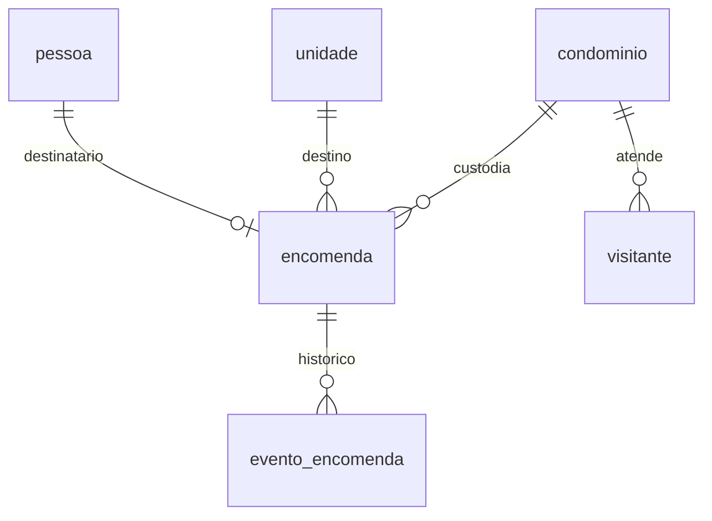

# Bounded Context 04: Portaria — Atendimento e Correspondências (Fase 2 / F2)

## Problem

Hoje a guarita e o morador não compartilham um fluxo confiável de correspondências: a API de encomendas existe sem escopo por papel, a tela Angular de `/portaria/encomendas` mostra dados mock e o morador **não vê** as encomendas da própria unidade no menu. O porteiro não tem um caminho auditável de baixa com PIN; o síndico não consegue confiar na listagem. Em paralelo, os pilares BC-01 e BC-02 já têm specs/checks, mas a suíte precisa ser reexecutada e a usabilidade das telas de identidade/portaria ainda deixa estados vazios e ações de gestão expostas de forma inconsistente.

Quando este trabalho entregar, o operador de **encomendas** (papel `ENCOMENDAS`) registra e dá baixa de pacotes de verdade; o papel `PORTARIA`/`PORTEIRO` libera entrada de visitantes **sem** operar correspondências; o morador consulta só as da sua unidade (com PIN visível); BC-01/BC-02 continuam verdes em `pytest`; e as telas de encomendas deixam de ser mock.

## Flow

Reusa `CurrentUserDep`, `resolver_escopo_cadastro` / `pode_editar_cadastros` em `app/core/rbac.py` (exists), JWT multi-tenant e o submódulo `portaria/encomendas` + `portaria/atendimento` (exists) em vez de criar um segundo domínio de pacotes.

1. Requisição autenticada → `get_current_user` (exists) — extrai `user_id`, `papeis`, `condominio_id`
2. `resolver_escopo_cadastro` (exists) — `ver_todos` (gestão/portaria) vs `unidade_ids` do morador; `pode_editar` só síndico/admin
3. `EncomendaService` / `VisitanteService` (exists) — listagem filtrada; create/baixa só `ENCOMENDAS` (+ gestão); create visitante só `PORTARIA`/`PORTEIRO` (+ gestão)
4. Baixa com PIN → valida `codigo_retirada`, persiste `status=ENTREGUE` e `retirada_em` (door 1)
5. out: JSON Pydantic → Angular `PortariaService` + `EncomendasComponent` (exists, hoje mock) — menu por papel: portaria→atendimento, encomendas→pacotes, morador→consulta PIN; estados empty/loading/erro

## Impact

| Front | What changes |
| --- | --- |
| domain | existing term: `encomenda` — pacote sob custódia da portaria com PIN de retirada; passa a ser filtrado por unidade para morador |
| domain | existing term: `visitante` — registro civil de atendimento na guarita; passa a exigir autenticação e escopo de condomínio |
| domain | existing term: papéis `PORTARIA` / `PORTEIRO` — liberação de entrada/visitantes (sem create/baixa de encomenda) |
| domain | new term: papel `ENCOMENDAS` — recebimento e baixa de correspondências/pacotes (sem liberar visitantes) |
| domain | existing term: papel `MORADOR` — só consulta encomendas da própria unidade |
| stored data | tabela `encomenda` já existe; seed cria usuário demo `encomendas@condourban.com` com `tipo_pessoa=ENCOMENDAS` + pacote Apt 101 |

## Relations

One-way constraints: encomenda sempre vinculada a uma unidade do condomínio; transição de status `RECEBIDA` → `ENTREGUE` só com PIN válido (door 1); morador nunca lista encomendas fora das próprias unidades.

## Surface

| Route | In | Out | Status |
| --- | --- | --- | --- |
| `GET /api/v1/portaria/encomendas` | auth, opcional `condominio_id` | lista filtrada por escopo | `200`, `401` |
| `POST /api/v1/portaria/encomendas` | `unidade_id`, `transportadora`, `codigo_rastreio`, `descricao`, opcional `destinatario_id` | `id`, `codigo_retirada`, `status` | `201`, `401`, `403`, `422` |
| `POST /api/v1/portaria/encomendas/{id}/baixa` | `codigo_retirada` | `id`, `status`, `retirada_em` | `200`, `400`, `401`, `403`, `404` |
| `GET /api/v1/portaria/visitantes` | auth, opcional `condominio_id` | lista visitantes | `200`, `401`, `403` |
| `POST /api/v1/portaria/visitantes` | dados do visitante + destino | `id`, `status` | `201`, `401`, `403`, `422` |

## Landing

| One-way door | Literal shape | Alternative rejected |
| --- | --- | --- |
| Baixa exige PIN | `POST .../baixa` com body `{ codigo_retirada }`; status só vira `ENTREGUE` se o PIN bate com `encomenda.codigo_retirada` | Baixa por clique sem PIN; desqualificado pela RN-01 da spec e pelo risco de extravio |
| Escopo morador por unidade | Listagem de encomendas para papéis sem `ver_todos` filtra `unidade_id IN unidade_ids` do JWT/ocupação | Morador ver estoque completo da guarita; desqualificado pela matriz RBAC da spec |
| Operação de pacotes ≠ edição civil | Create/baixa de encomenda permitidos a `ENCOMENDAS`/`ZELADOR` e síndico/admin; **não** a `PORTARIA`/`PORTEIRO`; não usam `pode_editar` civil | Exigir `ADMINISTRADOR` para registrar pacote; desqualificado porque a operação 24h não depende do síndico |
| Papéis portaria vs encomendas | `PORTARIA`/`PORTEIRO` operam visitantes; `ENCOMENDAS` opera create/baixa de pacotes; cross-POST retorna `403` | Papel único `PORTARIA` para entrada e pacotes; rejeitado — condomínios separam quem libera entrada de quem cuida da correspondência |

- Nothing else in this change is hard to reverse

## Criteria

### S1: Correspondências — registro, PIN e baixa (P1)

Operador `ENCOMENDAS` registra pacote; sistema gera PIN; baixa só com PIN correto; `PORTARIA` não opera pacotes.

**Acceptance Criteria**

1. WHEN um usuário com papel `ENCOMENDAS` autenticado submete `POST /api/v1/portaria/encomendas` com `unidade_id` válido THEN the system SHALL persistir a encomenda com `status=RECEBIDA`, gerar `codigo_retirada` de 4 dígitos e retornar `201`.
2. WHEN o mesmo operador consulta `GET /api/v1/portaria/encomendas` THEN the system SHALL retornar as encomendas do condomínio com status `200`.
3. WHEN o operador `ENCOMENDAS` chama `POST /api/v1/portaria/encomendas/{id}/baixa` com o PIN correto THEN the system SHALL alterar `status` para `ENTREGUE`, preencher `retirada_em` e retornar `200`.
4. IF a baixa for chamada com PIN incorreto THEN the system SHALL rejeitar com status `400` e detalhe `PIN_INVALIDO`.
5. IF um morador **ou** um usuário só com `PORTARIA`/`PORTEIRO` chamar `POST /api/v1/portaria/encomendas` THEN the system SHALL rejeitar com status `403`.

**Independent test:** Como `encomendas@condourban.com`, criar encomenda para Apt 101, listar, baixar com PIN errado (400) e com PIN certo (200/ENTREGUE); como `portaria@condourban.com`, POST encomendas → 403.

### S2: Morador vê só as encomendas da própria unidade (P1)

Consulta autenticada escopada; menu e UI sem mock.

**Acceptance Criteria**

6. WHEN um morador autenticado com ocupação na unidade U chama `GET /api/v1/portaria/encomendas` THEN the system SHALL retornar apenas encomendas com `unidade_id` em suas unidades ativas e status `200`.
7. IF existir encomenda de outra unidade no mesmo condomínio THEN the system SHALL não incluí-la na resposta do morador.
8. WHEN o morador autenticado abre a rota `/portaria/encomendas` THEN the system SHALL exibir a lista vinda da API (não mock) e o PIN das encomendas `RECEBIDA` da sua unidade.
9. WHILE o morador estiver autenticado the system SHALL expor no menu principal um acesso a Portaria/Encomendas e NÃO exigir perfil de gestão para essa consulta.
10. WHEN a lista do morador estiver vazia THEN the system SHALL mostrar estado vazio legível (sem cards mock).

**Independent test:** Login `morador@condourban.com`, GET encomendas contém só Apt 101; login admin vê também outras unidades.

### S3: Atendimento de visitantes autenticado (P1)

Visitantes na guarita com auth e escopo.

**Acceptance Criteria**

11. WHEN um usuário com papel `PORTARIA`/`PORTEIRO` autentica e chama `POST /api/v1/portaria/visitantes` com payload válido THEN the system SHALL persistir o visitante e retornar `201`.
12. WHEN a portaria chama `GET /api/v1/portaria/visitantes` THEN the system SHALL retornar a lista do condomínio com `200`.
13. IF um morador **ou** um usuário só com `ENCOMENDAS` chamar `POST /api/v1/portaria/visitantes` THEN the system SHALL rejeitar com status `403`.
14. IF a requisição não tiver Bearer token THEN the system SHALL responder `401` em visitantes e encomendas.

**Independent test:** `portaria@condourban.com` cria visitante; `encomendas@` e morador recebem 403 no POST visitantes; sem token recebe 401.

### S4: Regressão BC-01 e BC-02 + usabilidade mínima (P1)

Pilares de dados continuam verdes; telas deixam de mentir com mock.

**Acceptance Criteria**

15. WHEN a suíte `poetry run pytest` (ou equivalente do repo) for executada THEN the system SHALL manter verdes os testes existentes de BC-01 (`test_identidade*`, `test_ocupacao*`, `test_onboarding*`, `test_auth*`) e BC-02 (`test_condominio*`).
16. WHEN novos testes de portaria forem adicionados THEN the system SHALL cobrir os critérios 1–14 com provas `pytest` nomeadas e executáveis.
17. WHEN a tela de encomendas carrega com erro de API THEN the system SHALL exibir mensagem de erro sem dados fictícios.
18. WHEN o operador `ENCOMENDAS` visualiza encomendas THEN the system SHALL poder registrar retirada (baixa) na UI; o morador SHALL ver o PIN mas NÃO o botão de baixa; o menu de `PORTARIA` SHALL priorizar atendimento/visitantes sem ações de create/baixa de pacotes.

**Independent test:** Rodar pytest completo; inspecionar UI morador vs portaria.

## Out of scope

| Excluded | Why |
| --- | --- |
| OCR de etiqueta / leitor de código de barras | Spec F2 avançada; não bloqueia PIN + lista |
| Push notification real / FCM | Canal ainda sem provedor operacional no Marco atual |
| Smart Lockers | Explicitamente além do F2 mínimo |
| Agendamento de mudanças e achados/perdidos | Roadmap F3 dentro de BC-04 |
| Autorização de vizinho com PIN compartilhado (RN-03) | Fatia seguinte após baixa básica |
| Upload S3 de foto da etiqueta | Pode entrar depois; campo `foto_url` opcional permanece |

## Assumptions

| Assumption | Chosen default | Rationale | Confirmed? |
| --- | --- | --- | --- |
| Status canônico de recebida | `RECEBIDA` (não `RECEBIDO_PORTARIA` na API V1) | Já usado no modelo/seed pattern; mapear na UI | n |
| Status canônico de entregue | `ENTREGUE` | Alinhado à máquina de estados da spec | n |
| Quem opera create/baixa | Papéis `ENCOMENDAS`, `ZELADOR` + síndico/admin — **não** `PORTARIA`/`PORTEIRO` | Separação pedida: entrada ≠ correspondência | y |
| Quem opera visitantes | Papéis `PORTARIA`, `PORTEIRO` + síndico/admin — **não** `ENCOMENDAS` | Mesma separação no eixo inverso | y |
| Código do novo papel | `ENCOMENDAS` (alias de exibição: Operador de Encomendas / Correspondências) | Alinha ao submódulo e ADR-010 | y |
| Seed demo | `encomendas@condourban.com` / `admin123` com `tipo_pessoa=ENCOMENDAS`; `portaria@` permanece só entrada | Dois operadores distintos no demo | y |
| Menu do morador | Item "Portaria" leva a `/portaria/encomendas`; atendimento fica guardado para `PORTARIA` | Evita segundo módulo só para pacotes | n |
| Testes BC-01/BC-02 | Reexecutar suíte existente sem reescrever checks já aprovados | User pediu testar; não reabrir planos BC-01/02 | n |
| Usabilidade nesta fatia | Empty/loading/error + esconder baixa do morador + tirar mock | Escopo mínimo de UX pedido junto ao BC-04 | n |

**Open questions:** none — separação `PORTARIA` vs `ENCOMENDAS` confirmada pelo produto; confirme o plano revisado antes dos checks.

## Observable

| Surface | Decision | Landing |
| --- | --- | --- |
| screen `encomendas` | empty state | AC 10 |
| screen `encomendas` | loading state | AC 8 (lista da API) |
| screen `encomendas` | error state | AC 17 |
| screen `encomendas` | unauthorised | AC 9 + redirect existente authGuard |
| screen `encomendas` | destructive/baixa confirma | AC 18 — baixa só `ENCOMENDAS`; PIN no body |
| API `GET/POST /portaria/encomendas*` | error shape and codes | AC 4, 5, 14 |
| API `POST .../baixa` | error shape and codes | AC 4 |
| API `GET/POST /portaria/visitantes` | error shape and codes | AC 13, 14 |
| all new `/portaria/*` | versioning, rate limits | n/a — mesma versão `/api/v1` sem rate limit dedicado neste slice |

## Sources

- [correspondencias-encomendas.md](../../../docs/funcionalidades/04_portaria/correspondencias-encomendas.md) — matriz RBAC, PIN, estados RECEBIDO→ENTREGUE
- [03-roadmap-e-entregas.md](../../../docs/plano/03-roadmap-e-entregas.md) — Fase BC-04 / F2 visitantes+encomendas
- [04-status-e-proximos-passos.md](../../../docs/plano/04-status-e-proximos-passos.md) — BC-01/BC-02 concluídos; BC-04 próximo na trilha
