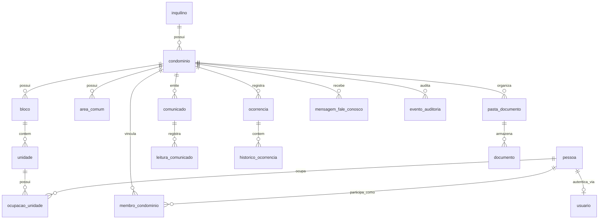

# Fase 1: Fundação + Convivência Diária

## Problem

Hoje os condomínios operam com cadastros fragmentados em planilhas desatualizadas, comunicações impressas que rasgam nos elevadores sem comprovação de leitura, e livros pretos de papel na guarita onde reclamações caluniosas e discussões entre vizinhos ficam expostas publicamente. Esse cenário gera atritos contínuos de convivência, insegurança jurídica para os síndicos em notificações e risco severo de vazamento de dados em desacordo com a LGPD.

Quando a Fase 1 for entregue, o condomínio passará a contar com uma plataforma integrada e segura: moradores autenticam-se via e-mail ou Google OAuth com isolamento estrito de dados por condomínio (multi-tenant via RLS), a gestão administra a estrutura de blocos e unidades autônomas, comunicados oficiais urgentes são notificados com leitura obrigatória comprovada, ocorrências e irregularidades são registradas com controle rigoroso de sigilo anti-retaliação, documentos normativos e regulatórios ficam centralizados digitalmente e um canal direto privado (Fale Conosco) elimina a abordagem informal aos síndicos.

## Flow

Este plano reutiliza o esqueleto de diretórios por 9 Bounded Contexts já estruturado em `backend/app/modules/` e o shell Angular PWA com lazy loading configurado em `frontend/src/app/features/`.

1. Requisição HTTP entra -> `FastAPI CORS e Auth Middleware` (exists) - valida token JWT ou Google ID Token, extrai claims (`sub`, `condominio_id`, `papeis`) e valida tenant
2. `Database Session Dependency` (exists) - executa `SET LOCAL app.condominio_id = :condominio_id` na conexão do banco para ativação do RLS (door 2)
3. `Identidade e Cadastro Service` (exists) - resolve `pessoa` civil e credencial `usuario` (door 1), persiste membros e ocupações em `membro_condominio` e `ocupacao_unidade`
4. `Condomínio Service` (exists) - gerencia e valida unicidade da malha física de `bloco`, `unidade` e `area_comum`
5. `Comunicação Service` (exists) - processa avisos em `comunicado` com controle de leitura em `leitura_comunicado`, chamados em `ocorrencia` unificada (door 5) e mensagens em `mensagem_fale_conosco`
6. `Governança Service` (exists) - gerencia pastas em `pasta_documento` e arquivos em `documento` com controle de sigilo
7. `Auditoria Interceptor` (exists) - persiste trilha forense imutável em `evento_auditoria` (door 4)
8. out: `JSON Response` tipada via schemas Pydantic v2 com status HTTP explícito, consumida pelo client Angular Morador PWA (exists)

## Impact

| Front | What changes |
| --- | --- |
| domain | new term: `inquilino` - organização multi-tenant proprietária dos condomínios no SaaS, vive em app.modules.condominio |
| domain | new term: `pessoa` - indivíduo físico portador de dados civis e direitos LGPD, vive em app.modules.identidade_cadastro |
| domain | new term: `usuario` - credencial de autenticação (e-mail/senha ou Google) vinculada a uma pessoa, vive em app.modules.identidade_cadastro |
| domain | new term: `comunicado` - aviso oficial unidirecional da gestão para os condôminos com leitura rastreada, vive em app.modules.comunicacao |
| domain | new term: `ocorrencia` - registro digital unificado de infração ou solicitação com sigilo, vive em app.modules.comunicacao |
| stored data | migração Alembic inicial criando tabelas relacionais em SQLite (dev) e habilitando RLS multi-tenant no PostgreSQL 16+ (staging/prod) |

## Relations

One-way constraints: email estritamente unique em usuario (door 1), cpf_hash indexado para busca determinística sem descriptografar em pessoa (door 1), combinação (condominio_id, identificacao, bloco_id) unique em unidade (door 3), combinação (comunicado_id, pessoa_id) unique em leitura_comunicado (door 6).

## Surface

| Route | In | Out | Status |
| --- | --- | --- | --- |
| `POST /api/v1/auth/login` | `email`, `senha` | `access_token`, `token_tipo`, `condominios` | `200`, `401`, `422` |
| `POST /api/v1/auth/google` | `id_token` | `access_token`, `token_tipo`, `condominios` | `200`, `401`, `422` |
| `POST /api/v1/auth/selecionar-condominio` | `condominio_id` | `access_token`, `condominio_ativo` | `200`, `403`, `422` |
| `GET /api/v1/identidade/pessoas/me` | `nenhum` | `id`, `nome_completo`, `email`, `unidades` | `200`, `401` |
| `POST /api/v1/identidade/convites` | `unidade_id`, `nome_completo`, `email`, `tipo_vinculo` | `convite_id`, `token`, `expira_em` | `201`, `400`, `403`, `422` |
| `POST /api/v1/condominio/blocos` | `nome`, `descricao` | `id`, `nome`, `condominio_id` | `201`, `400`, `403`, `422` |
| `POST /api/v1/condominio/unidades` | `bloco_id`, `identificacao`, `andar`, `area_privativa` | `id`, `identificacao`, `bloco_id` | `201`, `400`, `403`, `422` |
| `POST /api/v1/condominio/unidades/importar` | `arquivo_csv` | `unidades_criadas`, `erros` | `200`, `400`, `403`, `422` |
| `GET /api/v1/comunicacao/comunicados` | `bloco_id`, `apenas_urgentes`, `pagina`, `limite` | `itens`, `total`, `pagina` | `200`, `401` |
| `POST /api/v1/comunicacao/comunicados` | `titulo`, `conteudo`, `urgente`, `fixado`, `publico_bloco_id` | `id`, `titulo`, `criado_em` | `201`, `400`, `403`, `422` |
| `POST /api/v1/comunicacao/comunicados/{id}/confirmar-leitura` | `id` | `comunicado_id`, `lido_em` | `200`, `404`, `422` |
| `GET /api/v1/comunicacao/ocorrencias` | `status`, `origem`, `pagina`, `limite` | `itens`, `total`, `pagina` | `200`, `401` |
| `POST /api/v1/comunicacao/ocorrencias` | `titulo`, `descricao`, `unidade_id`, `categoria`, `sigilosa` | `id`, `titulo`, `status` | `201`, `400`, `403`, `422` |
| `POST /api/v1/comunicacao/ocorrencias/{id}/eventos` | `id`, `mensagem`, `tipo` | `id`, `ocorrencia_id`, `criado_em` | `201`, `403`, `404`, `422` |
| `PATCH /api/v1/comunicacao/ocorrencias/{id}/status` | `id`, `novo_status`, `parecer` | `id`, `status`, `atualizado_em` | `200`, `400`, `403`, `404`, `422` |
| `GET /api/v1/governanca/documentos` | `pasta_id`, `busca` | `pastas`, `documentos` | `200`, `401` |
| `POST /api/v1/governanca/documentos` | `pasta_id`, `nome`, `arquivo`, `visibilidade` | `id`, `nome`, `versao` | `201`, `400`, `403`, `422` |
| `POST /api/v1/comunicacao/fale-conosco` | `assunto`, `mensagem`, `destinatario_id` | `id`, `assunto`, `enviada_em` | `201`, `400`, `403`, `422` |
| `GET /api/v1/comunicacao/fale-conosco` | `pagina`, `limite` | `itens`, `total` | `200`, `401` |

## Landing

| One-way door | Literal shape | Alternative rejected |
| --- | --- | --- |
| Separação civil e conta de acesso | Tabela `pessoa` (dados civis LGPD) isolada de `usuario` (`email` CITEXT UNIQUE, `senha_hash`, `google_sub` UNIQUE) | Mesclar dados civis e credenciais em uma única tabela; desqualificado por impedir o cadastro de dependentes/crianças sem credenciais e violar o ADR-008 |
| Isolamento multi-tenant via RLS | Injeção de `SET LOCAL app.condominio_id = :id` no PostgreSQL e policy `condominio_id = obter_condominio_sessao()` | Filtro manual exclusivo na cláusula WHERE do SQLAlchemy; desqualificado pelo risco inaceitável de vazamento de dados entre condomínios caso um desenvolvedor esqueça o filtro |
| Nomenclatura canônica de banco em pt-BR | Identificadores snake_case sem acento: `inquilino`, `condominio`, `bloco`, `unidade`, `ocupacao_unidade`, `comunicado`, `ocorrencia` | Nomenclatura em inglês ou híbrida; desqualificado por violar o ADR-010 e introduzir inconsistência conceitual entre termos de negócio condominial e código |
| Trilha forense imutável de auditoria | Tabela append-only `evento_auditoria` com colunas `id UUID`, `condominio_id UUID`, `usuario_id UUID`, `pessoa_id UUID`, `acao VARCHAR`, `entidade VARCHAR`, `entidade_id UUID`, `ocorrido_em TIMESTAMPTZ`, `id_correlacao VARCHAR` | Gravação exclusiva em logs de arquivo texto rotativos; desqualificado por impedir consultas analíticas relacionais por tenant e auditorias periciais requeridas judicialmente |
| Unificação do livro de ocorrências | Tabela única `ocorrencia` contendo coluna `origem VARCHAR(20) CHECK (origem IN ('MORADOR', 'PORTARIA', 'GESTAO'))` e flag `sigilosa BOOLEAN` | Criação de tabelas separadas para livro da portaria e ocorrências de moradores; desqualificado por fragmentar a gestão do síndico, duplicar a máquina de estados e violar o ADR-013 |
| Unicidade de leitura por comunicado | Constraint `UNIQUE (comunicado_id, pessoa_id)` na tabela `leitura_comunicado` | Permitir leituras duplicadas agregadas por agregação em memória; desqualificado por corromper relatórios percentuais de ciência e criar concorrência de escrita desnecessária |

- Nothing else in this change is hard to reverse

## Criteria

### S1: Autenticação Segura, Multi-tenancy e Sessão Ativa (P1)

Fluxo completo de login, validação de token, injeção de tenant ativo e auditoria de acesso.

**Acceptance Criteria**

1. WHEN o usuário envia credenciais válidas de e-mail e senha para `POST /api/v1/auth/login` THEN the system SHALL retornar status 200 com token JWT contendo as claims `sub`, `condominio_id` e `papeis`.
2. IF as credenciais de autenticação forem inválidas THEN the system SHALL retornar status 401 com o código de erro `CREDENCIAIS_INVALIDAS`.
3. WHEN o usuário envia um ID Token do Google válido para `POST /api/v1/auth/google` THEN the system SHALL validar o token via OIDC e retornar status 200 com token JWT e lista de condomínios vinculados.
4. WHEN uma requisição autenticada é recebida na API THEN the system SHALL executar `SET LOCAL app.condominio_id = :condominio_id` antes de qualquer consulta no banco de dados.
5. IF uma consulta tentar acessar registros pertencentes a outro condomínio diferente de `app.condominio_id` THEN the system SHALL retornar conjunto vazio por aplicação de Row-Level Security no PostgreSQL.
6. The system SHALL registrar cada evento de login e alteração de credencial na tabela `evento_auditoria` com `endereco_ip`, `id_correlacao` e carimbo de data/hora.

**Independent test:** Executar script de teste automatizado autenticando dois usuários de condomínios distintos e comprovando vazamento zero de dados e geração do registro de auditoria.

### S2: Estrutura Física e Gestão de Pessoas e Ocupações (P1)

Mapeamento da árvore física do condomínio e cadastro civil de moradores e dependentes.

**Acceptance Criteria**

7. WHEN um usuário com papel `SINDICO` ou `ADMINISTRADORA` envia dados válidos para `POST /api/v1/condominio/blocos` THEN the system SHALL criar o bloco e retornar status 201 com o ID gerado.
8. WHEN um usuário com papel `SINDICO` ou `ADMINISTRADORA` envia dados válidos para `POST /api/v1/condominio/unidades` THEN the system SHALL criar a unidade vinculada ao bloco com status 201.
9. IF houver tentativa de cadastrar uma unidade com a mesma identificação dentro do mesmo bloco e condomínio THEN the system SHALL rejeitar a criação com status 400 e código `UNIDADE_DUPLICADA`.
10. WHEN o morador titular envia um convite para dependente em `POST /api/v1/identidade/convites` THEN the system SHALL gerar token criptográfico com validade de 7 dias e retornar status 201.
11. IF um convite for aceito após decorridos 7 dias de sua criação THEN the system SHALL rejeitar o ingresso com status 400 e código `CONVITE_EXPIRADO`.
12. The system SHALL permitir a criação de registros na tabela `pessoa` sem criação obrigatória de registro correspondente em `usuario`.

**Independent test:** Criar um condomínio com 2 blocos e 4 unidades, cadastrar titular e dependente sem login, e validar integridade referencial e unicidade.

### S3: Mural Oficial de Comunicados com Confirmação Obrigatória (P2)

Publicação institucional com segmentação por torre e leitura obrigatória bloqueante para avisos urgentes.

**Acceptance Criteria**

13. WHEN um usuário com papel `SINDICO` ou `ADMINISTRADORA` envia um comunicado para `POST /api/v1/comunicacao/comunicados` THEN the system SHALL persistir o comunicado com status 201 e enfileirar evento de notificação aos moradores elegíveis.
14. WHILE houver comunicado com a flag `urgente = true` sem leitura confirmada pelo morador logado the system SHALL exigir confirmação explícita no app Angular impedindo a navegação nas demais telas.
15. WHEN o morador confirma a leitura através de `POST /api/v1/comunicacao/comunicados/{id}/confirmar-leitura` THEN the system SHALL registrar a ciência em `leitura_comunicado` e retornar status 200.
16. IF um usuário com papel `MORADOR` tentar publicar um comunicado oficial em `POST /api/v1/comunicacao/comunicados` THEN the system SHALL retornar status 403 com código `PERMISSAO_NEGADA`.

**Independent test:** Publicar comunicado urgente para a Torre A, efetuar login com morador da Torre A, constatar bloqueio em modal, registrar ciência e constatar desbloqueio imediato.

### S4: Livro Digital Unificado de Ocorrências e Sigilo Anti-Retaliação (P2)

Registro centralizado de ocorrências por moradores e portaria com preservação de sigilo e histórico.

**Acceptance Criteria**

17. WHEN um morador autenticado submete uma ocorrência em `POST /api/v1/comunicacao/ocorrencias` THEN the system SHALL registrar o chamado com status inicial `ABERTA`, gravar `origem = 'MORADOR'` e retornar status 201.
18. WHEN um porteiro autenticado registra uma irregularidade em `POST /api/v1/comunicacao/ocorrencias` THEN the system SHALL registrar o chamado com `origem = 'PORTARIA'` e status 201.
19. WHILE uma ocorrência estiver gravada com `sigilosa = true` the system SHALL omitir a identificação do autor e unidade em consultas efetuadas por usuários sem papel de `SINDICO` ou `ADMINISTRADORA`.
20. WHEN a gestão envia uma transição de estado para `PATCH /api/v1/comunicacao/ocorrencias/{id}/status` THEN the system SHALL registrar a alteração em `historico_ocorrencia` e retornar status 200.
21. IF um usuário sem perfil administrativo tentar visualizar detalhes de ocorrência sigilosa criada por outro condômino THEN the system SHALL retornar status 404.

**Independent test:** Abrir ocorrência sigilosa com morador da Unidade 101 e verificar que morador da Unidade 102 não a localiza, enquanto o síndico visualiza a autoria e tramita o status.

### S5: Repositório Regulatório e Documental com Controle de Acesso (P3)

Biblioteca digital de convenção, regimento e atas com controle de permissão por pasta.

**Acceptance Criteria**

22. WHEN a gestão envia um arquivo para `POST /api/v1/governanca/documentos` THEN the system SHALL persistir os metadados do documento em `documento` e retornar status 201 com o ID gerado.
23. WHERE a visibilidade da pasta for `ADMINISTRADORES` the system SHALL permitir o download de arquivos apenas para usuários autenticados com papéis de `SINDICO` ou `ADMINISTRADORA`.
24. IF um morador sem papel de gestão tentar baixar um documento de visibilidade restrita THEN the system SHALL retornar status 403 com código `ACESSO_RESTRITO`.
25. The system SHALL identificar documentos de conformidade predial com data de vencimento inferior a 30 dias corridos e sinalizar alerta no painel da gestão.

**Independent test:** Realizar upload de regimento interno como público e contrato com administradora como restrito, verificando permissões de download por perfil.

### S6: Canal Fale Conosco Morador ↔ Administração (P3)

Atendimento direto assíncrono para solicitações da unidade com SLA e avaliação de encerramento.

**Acceptance Criteria**

26. WHEN um morador envia uma mensagem para `POST /api/v1/comunicacao/fale-conosco` THEN the system SHALL criar o chamado em `mensagem_fale_conosco` com status 201 e registrar o prazo de SLA de 48 horas úteis.
27. WHEN um usuário autenticado consulta `GET /api/v1/comunicacao/fale-conosco` THEN the system SHALL retornar status 200 contendo apenas as conversas de sua própria unidade caso seja morador ou todas do condomínio caso seja síndico.

**Independent test:** Enviar mensagem de solicitação como morador e responder como síndico, comprovando isolamento de leitura e cálculo de SLA.

### S7: Shell Angular PWA, Proteção de Rotas e Web Push (P2)

Arquitetura frontend em Angular 22+ Standalone com guarda de rotas e recursos PWA.

**Acceptance Criteria**

28. WHILE o usuário não possuir token JWT ativo em armazenamento seguro the system SHALL redirecionar qualquer tentativa de acesso a rotas privadas para `/auth/login` via `authGuard`.
29. IF um usuário autenticado com papel `MORADOR` tentar acessar rota com permissão exclusiva de gestão THEN the system SHALL bloquear a navegação via `papelGuard` e redirecionar para a rota `/comunicacao`.
30. The system SHALL fornecer manifesto web `manifest.webmanifest` e Service Worker ativo permitindo a instalação do aplicativo como Progressive Web App (PWA).

**Independent test:** Acessar rota protegida sem autenticação, constatar redirecionamento, autenticar com morador e verificar restrição de menu administrativo no Angular.

## Out of scope

| Excluded | Why |
| --- | --- |
| Gateways de pagamento bancário (boletos/Pix dinâmico) | Adiado para a Fase 4 (gestão financeira via contabilidade externa no degrau P3 conforme ADR-011) |
| Reconhecimento facial biométrico e integração Intelbras | Pertence ao Bounded Context de Controle de Acesso planejado para a Fase 2 (ADR-004) |
| Agendamento e vistoria de áreas comuns | Módulo de Reservas de Espaços Comuns planejado para a Fase 2 |
| Assembleias virtuais com votação e apuração por fração ideal | Módulo de Governança Avançada planejado para a Fase 3 |
| Acionamento remoto de portões com geofencing | Módulo de automação predial planejado para a Fase 4 |

## Assumptions

| Assumption | Chosen default | Rationale | Confirmed? |
| --- | --- | --- | --- |
| Persistência local em ambiente de desenvolvimento | SQLite arquivo dev.db e testes em memória | Agilidade no ciclo TDD e execução sem exigência imediata de PostgreSQL local (ADR-005) | y |
| Validade padrão do access token JWT | 60 minutos com refresh token de 7 dias | Equilíbrio entre segurança e ergonomia do aplicativo móvel PWA | y |
| Formato de importação em lote da malha de unidades | Arquivo CSV com cabeçalho padronizado | Maior compatibilidade com sistemas legados de administradoras | y |

**Open questions:** none - all resolved or logged above.

## Observable

| Surface | Decision | Landing |
| --- | --- | --- |
| screen `login` | empty state, loading e mensagens de credenciais inválidas | AC 2 |
| screen `mural-comunicados` | empty state quando não há comunicados ativos | existing - componente card padrão com ilustração vazia |
| screen `mural-comunicados` | modal bloqueante para avisos urgentes | AC 14 |
| screen `livro-ocorrencias` | empty state e filtro de sigilo | AC 19 |
| screen `documentos` | visualizador de PDF e indicação de permissão restrita | AC 23 |
| screen `fale-conosco` | linha do tempo de mensagens e indicador de SLA | AC 26 |
| screen `todas as telas privadas` | proteção contra usuário desautenticado | AC 28 |
| API `POST /api/v1/auth/login` | error shape e códigos 401/422 | AC 2 |
| API `POST /api/v1/auth/google` | validação OIDC e erro de token expirado | AC 3 |
| API `POST /api/v1/identidade/convites` | expiração de token e unicidade de e-mail | AC 10, AC 11 |
| API `POST /api/v1/condominio/unidades` | erro de duplicação de unidade | AC 9 |
| API `POST /api/v1/comunicacao/comunicados` | controle de permissão e leitura obrigatória | AC 13, AC 16 |
| API `POST /api/v1/comunicacao/ocorrencias` | preservação de sigilo e status 404 | AC 19, AC 21 |
| API `POST /api/v1/governanca/documentos` | bloqueio de download não autorizado | AC 24 |
| all new `/api/v1/*` | rate limit e cabeçalhos de auditoria | n/a - tratado globalmente via middleware transversal |

## Sources

- `docs/plano/03-roadmap-e-entregas.md` §Fase 1 - escopo canônico e entregas da Fase 1
- `docs/funcionalidades/01_identidade_cadastro/onboarding-e-conta.md` - especificação de contas e membros
- `docs/funcionalidades/02_condominio/estrutura-fisica.md` - especificação da malha física
- `docs/funcionalidades/06_comunicacao/mural-comunicados.md` - especificação de comunicados
- `docs/funcionalidades/06_comunicacao/ocorrencias-livro.md` - especificação de ocorrências
- `docs/funcionalidades/07_governanca/repositorio-documentos.md` - repositório regulatório
- `docs/funcionalidades/06_comunicacao/canal-fale-conosco.md` - canal Fale Conosco
- `docs/decisoes/ADR-013-organizacao-diretorios.md` - organização canônica por 9 Bounded Contexts
