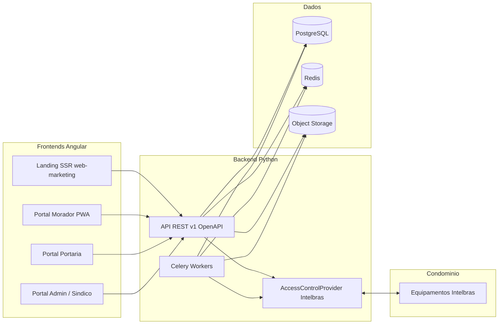

# Arquitetura técnica

> Stack definitiva: [ADR-001: Governança de documentação e stack tecnológica definitiva](../decisoes/ADR-001-documentacao-e-stack-tecnologica.md) (Python FastAPI + Angular).

## Visão lógica (alvo produção)

> Dev cedo: SQLite + rate-limit in-process no lugar de Postgres/Redis — [ADR-005](../decisoes/ADR-005-persistencia-sqlite-para-postgres.md).



## Stack definitiva (Python FastAPI + Angular)

Conforme [ADR-001: Governança de documentação e stack definitiva](../decisoes/ADR-001-documentacao-e-stack-tecnologica.md):

| Camada | Tecnologia | Observação |
|--------|------------|------------|
| Frontend | Angular 22+ (TypeScript) | Componentes standalone, Signals, Signal Forms, guards por perfil; [ADR-001](../decisoes/ADR-001-documentacao-e-stack-tecnologica.md) |
| PWA | @angular/service-worker | Web responsiva desktop/tablet/mobile + instalação PWA; [ADR-003](../decisoes/ADR-003-ui-estilizacao-e-portabilidade-web.md) |
| UI | Angular Material + Tailwind CSS | Componentes de interface e tokens de design; [ADR-003](../decisoes/ADR-003-ui-estilizacao-e-portabilidade-web.md) |
| Deploy | Docker na **VPS** | Proxy reverso TLS, API FastAPI + Celery workers + Nginx frontend |
| API | **FastAPI** (Python 3.14+) | Totalmente assíncrona, SQLAlchemy 2.0 async + Alembic; rotas `/api/v1/` |
| Auth | **JWT na API**: e-mail/senha **+ Google OAuth 2.0**; **sem Keycloak** — [ADR-007](../decisoes/ADR-007-autenticacao-jwt-aplicacao.md); RBAC unificado no backend |
| DB | SQLite (dev/testes) → **PostgreSQL** (staging/prod) | Escada [ADR-005](../decisoes/ADR-005-persistencia-sqlite-para-postgres.md); isolamento RLS [ADR-006](../decisoes/ADR-006-isolamento-rls-postgresql.md); nomes pt-BR [ADR-010](../decisoes/ADR-010-nomenclatura-pt-br.md) |
| Filas | Síncrono/dev → Celery + Redis | Redis também para rate-limit buckets em staging+ |
| Arquivos | Local/dev → S3-compatible | Presigned URLs em produção |
| Contrato | OpenAPI 3 | Client gerado para Angular no CI |

## Persistência e crescimento (obrigatório ler)

Não exigir PostgreSQL/Redis/Celery no primeiro commit. Caminho em escada:

1. **Testes:** SQLite `:memory:`
2. **Dev / spike:** SQLite arquivo (`dev.db`) — leve, “quase memória”, sem ops
3. **Staging/prod:** PostgreSQL com RLS; Redis para cache e buckets; Celery quando houver jobs reais
4. Modelos desenhados para Postgres (tipos/constraints); chave de troca via `DATABASE_URL`

## Princípios de arquitetura (desde a Fase 1)

- **Estrutura por 9 Bounded Contexts** — formalizada no [ADR-013](../decisoes/ADR-013-organizacao-diretorios.md) e [Estrutura.md](../decisoes/Estrutura.md): código, rotas, entidades e ownership modularizados por contexto de negócio em pt-BR.
- **API versionada**; breaking changes só em `/api/v2/`.
- **Multi-tenant** por condomínio via coluna `condominio_id` com **Row-Level Security (RLS)** no PostgreSQL ([ADR-006](../decisoes/ADR-006-isolamento-rls-postgresql.md)).
- **Eventos internos**: transactional outbox ou fila assíncrona para comunicação entre contextos.
- **Sem atalhos de MVP** que violem isolamento de dados de tenant, fronteiras de contexto ou trilha pericial de auditoria.
- **Infra em escada** — começar leve (SQLite), evoluir para Postgres/Redis/Celery/CDN sem reescrever domínio.

## Estrutura por Bounded Contexts (9 Contextos Canônicos)

O backend (`backend/app/modulos/`) e o frontend (`frontend/src/app/features/`) seguem estritamente os **9 Bounded Contexts** em português ([ADR-013](../decisoes/ADR-013-organizacao-diretorios.md)). Cada contexto possui submódulos bem delimitados, modelos de dados, schemas e serviços próprios:

| # | Bounded Context (`pt-BR`) | Submódulos e Responsabilidades | Entidades Principais | Mapeamento Backend / Frontend |
|---|---------------------------|--------------------------------|----------------------|--------------------------------|
| 1 | **`identidade_cadastro`** | Dados civis de pessoas, usuários/contas, membros/ocupações, onboarding e veículos/pets | `pessoa`, `usuario`, `membro_condominio`, `ocupacao_unidade`, `veiculo`, `pet` | `modulos/identidade_cadastro/` · `features/identidade_cadastro/` |
| 2 | **`condominio`** | Estrutura física (blocos, unidades, garagens), catálogo de áreas comuns, branding e regras | `condominio`, `bloco`, `unidade`, `vaga_garagem`, `area_comum` | `modulos/condominio/` · `features/condominio/` |
| 3 | **`controle_acesso`** ⭐ | Hardware, credenciais RFID/QR/LPR, facial (Intelbras), acionamentos remotos e passagens | `dispositivo_acesso`, `credencial_acesso`, `autorizacao_acesso`, `evento_acesso` | `modulos/controle_acesso/` · `features/controle_acesso/` |
| 4 | **`portaria`** | Terminal da guarita, atendimento visitantes/prestadores, encomendas, mudanças e achados/perdidos | `visitante`, `registro_visita`, `encomenda`, `agendamento_mudanca`, `item_perdido` | `modulos/portaria/` · `features/portaria/` |
| 5 | **`reservas`** | Agendamento de áreas comuns, regras de concorrência, lista de convidados e vistorias pré/pós | `reserva`, `regra_espaco`, `convidado_reserva`, `vistoria_reserva` | `modulos/reservas/` · `features/reservas/` |
| 6 | **`comunicacao`** | Mensageria oficial, confirmação de leitura, livro de ocorrências, enquetes, mural e Fale Conosco | `comunicado`, `leitura_comunicado`, `ocorrencia`, `enquete`, `voto_enquete` | `modulos/comunicacao/` · `features/comunicacao/` |
| 7 | **`governanca`** | Assembleias digitais/híbridas (Lei 14.309), pautas, votações, procurações, atas e repositório normativo | `assembleia`, `pauta_assembleia`, `voto_assembleia`, `documento_normativo` | `modulos/governanca/` · `features/governanca/` |
| 8 | **`financeiro`** | Emissão de boletos, Pix dinâmico instantâneo, conciliação, prestação de contas e renegociações | `cobranca_condominial`, `fatura`, `pagamento`, `termo_acordo` | `modulos/financeiro/` · `features/financeiro/` |
| 9 | **`manutencao`** | Chamados corretivos, ordens de serviço (OS zelador) e plano de manutenção preventiva (NBR 5674) | `chamado_manutencao`, `ordem_servico`, `item_preventiva_pmo` | `modulos/manutencao/` · `features/manutencao/` |
| 10 | **`transversal`** | RBAC, auditoria pericial (`AuditLog`), catálogo SaaS de planos/entitlements, rate-limit e anti-DDoS | `evento_auditoria`, `plano`, `funcionalidade`, `condominio_funcionalidade` | `app/core/` · `src/app/core/` |

### Regras de Engenharia entre Bounded Contexts

1. **Isolamento de modelos:** Um Bounded Context não importa modelos internos de outro diretamente no banco; a comunicação entre contextos ocorre via interfaces de serviço, eventos de domínio ou IDs de referência.
2. **Backend FastAPI:** Cada Bounded Context reside em `backend/app/modulos/{contexto}/`, contendo seus próprios `router.py`, `models.py`, `schemas.py` e `service.py`.
3. **Frontend Angular:** Cada Bounded Context reside em `frontend/src/app/features/{contexto}/`, carregado sob demanda (lazy loading) via rotas protegidas por guards de papel (`papel.guard.ts`).
4. **OpenAPI e Tags:** Endpoints são agrupados no Swagger/OpenAPI pelas tags correspondentes aos Bounded Contexts em português (ex: `Identidade e Cadastro`, `Controle de Acesso`, `Portaria`).
5. **Nomenclatura pt-BR:** Tabelas e colunas utilizam português padronizado ([ADR-010](../decisoes/ADR-010-nomenclatura-pt-br.md)).
6. **Segurança e Tenancy:** Políticas de RLS e autenticação são transversais (`app/core/`), sem necessidade de reinvenção dentro de cada contexto.

Rastreabilidade completa: [`docs/funcionalidades/MAPA.md`](../funcionalidades/MAPA.md) e especificações em [`docs/funcionalidades/`](../funcionalidades/README.md).

## Estrutura do Repositório (Alvo Canônico)

Conforme formalizado em [docs/decisoes/Estrutura.md](../decisoes/Estrutura.md):

```text
gestao_condominios/
├── backend/
│   ├── alembic/
│   ├── app/
│   │   ├── core/                  # Segurança, JWT, Banco assíncrono, RLS, middleware
│   │   └── modulos/               # 9 Bounded Contexts (FastAPI)
│   │       ├── identidade_cadastro/
│   │       ├── condominio/
│   │       ├── controle_acesso/   # Dispositivos, credenciais, facial Intelbras
│   │       ├── portaria/          # Atendimento, encomendas, mudanças, achados
│   │       ├── reservas/          # Espaços comuns, regras, convidados, vistorias
│   │       ├── comunicacao/       # Mensageria, ocorrências, enquetes, mural
│   │       ├── governanca/        # Assembleias, atas, documentos normativos
│   │       ├── financeiro/        # Boletos, Pix, prestação de contas
│   │       └── manutencao/        # Chamados, OS zelador, preventivas PMO
│   └── main.py
│
├── frontend/
│   └── src/app/
│       ├── core/                  # Guards (auth, papel, tenant), interceptors, services
│       ├── shared/                # Componentes reutilizáveis (tabelas, modais, cards)
│       └── features/              # 9 Bounded Contexts (Angular PWA)
│           ├── identidade_cadastro/
│           ├── condominio/
│           ├── controle_acesso/
│           ├── portaria/
│           ├── reservas/
│           ├── comunicacao/
│           ├── governanca/
│           ├── financeiro/
│           └── manutencao/
│
└── docs/
    ├── decisoes/                  # ADRs consolidadas (001 a 013) + Estrutura.md
    ├── funcionalidades/           # 9 Bounded Contexts (domínios + 26 especificações + MAPA.md)
    └── plano/                     # Planos 00 a 18 + INDICE.md
```

## Segurança

Plano detalhado: [13-seguranca-plataforma-logs-e-ddos.md](13-seguranca-plataforma-logs-e-ddos.md). Ritual por feature: [10](10-seguranca-faq-politicas-ritual.md).

- **RBAC granular:** Perfis (morador, síndico, porteiro, zelador, conselho, administradora) validados via `papel.guard.ts` no frontend e `dependencies.py` no backend FastAPI.
- **`evento_auditoria`:** Trilha pericial imutável append-only para login, alterações de papel, liberação de acessos, votações e pagamentos.
- **Rate limiting em Redis:** Proteção por token bucket para IPs, autenticação, acionamento de portões e endpoints sensíveis.
- **DDoS e borda:** CDN/WAF (Cloudflare ou similar) na frente da VPS, com proxy reverso Nginx e respostas 429 automáticas.
- **LGPD:** Consentimento explícito para biometria facial, retenção controlada de logs e exportação/exclusão de dados pessoais.
- **Isolamento de dados:** PostgreSQL com Row-Level Security ([ADR-006](../decisoes/ADR-006-isolamento-rls-postgresql.md)).

## Status deste documento

| Campo | Valor |
|-------|-------|
| Status | `vivo` |
| Última revisão | 2026-10-17 — alinhamento aos 9 Bounded Contexts (ADR-013) e stack definitiva FastAPI + Angular (ADR-001) |
| ADRs | [ADR-001](../decisoes/ADR-001-documentacao-e-stack-tecnologica.md), [ADR-003](../decisoes/ADR-003-ui-estilizacao-e-portabilidade-web.md), [ADR-005](../decisoes/ADR-005-persistencia-sqlite-para-postgres.md), [ADR-006](../decisoes/ADR-006-isolamento-rls-postgresql.md), [ADR-010](../decisoes/ADR-010-nomenclatura-pt-br.md), [ADR-013](../decisoes/ADR-013-organizacao-diretorios.md) |
