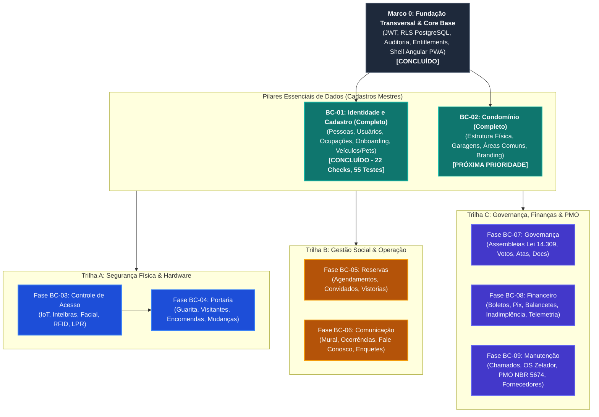

# Roadmap e Entregas por Bounded Contexts

Roadmap alinhado à arquitetura de **9 Bounded Contexts** ([ADR-013](../decisoes/ADR-013-organizacao-diretorios.md), [Estrutura.md](../decisoes/Estrutura.md)) e à metodologia **`tlc-spec-lean`**. 

Diferente do modelo legado de fases fragmentadas, cada fase aqui representa o **desenvolvimento completo e unificado de um Bounded Context**, garantindo que todas as suas regras de negócio, tabelas DDL, models SQLAlchemy, schemas Pydantic, serviços, rotas FastAPI e componentes Angular PWA sejam entregues juntos em uma release utilizável e auditada.

---

## Critérios de Pronto (Definition of Done) por Bounded Context

Cada entrega de Bounded Context só é considerada pronta quando:
1. **Modelagem e DDL:** Tabelas, colunas, enums em pt-BR snake_case e constraints ANSI SQL (`00X-*.sql`) operacionais com RLS multi-tenant ativo.
2. **Backend FastAPI:** Submódulos organizados estritamente no padrão de 4 arquivos (`router.py`, `models.py`, `schemas.py`, `service.py`) com injeção de dependências e tipagem Pydantic v2.
3. **Frontend Angular PWA:** Componentes Standalone com Signals (`signal`, `computed`), controle de fluxo `@if`/`@for`, Angular Material e Tailwind CSS integrados.
4. **Metodologia `tlc-spec-lean`:** Artefatos `.specs/features/<bc-slug>/` completos:
   - `plan.md`: Problema, fluxos, relações (ERD), superfície de rotas, portas de sentido único (Landing) e critérios EARS.
   - `checks.md`: Reivindicações observáveis com provas de teste `pytest` e tabela de cobertura (Coverage Join).
   - `verification.md`: Verificação independente com aprovação via script determinístico.
5. **Governança e Rastreabilidade:** Especificação funcional sincronizada em `docs/funcionalidades/`, [MAPA.md](../funcionalidades/MAPA.md) atualizado e registro no [CHANGELOG.md](../historico/CHANGELOG.md).

---

## Topologia de Fases e Matriz de Paralelização

As entregas organizam-se a partir de uma fundação transversal sólida (**Marco 0**), avançando para os **Pilares Essenciais de Dados** (`BC-01` e `BC-02`) e abrindo **trilhas paralelas independentes**:

### Síntese dos Estágios de Desenvolvimento

| Estágio | Foco / Contextos | Pré-requisitos | Paralelização |
| :---: | :--- | :--- | :--- |
| **Marco 0** | **`Fundação Transversal & Core Base`** | Nenhum | **Concluído e auditado** (30 checks sob `.specs/features/fase-1-fundacao/`). |
| **Estágio 1** | **Pilares Essenciais de Dados:** • **`BC-01: Identidade e Cadastro`** *(Concluído)* • **`BC-02: Condomínio`** *(Próxima Fase)* | Marco 0 | **100% Paralelizáveis entre si.** Formam o modelo mestre de dados de pessoas e unidades indispensável para todos os módulos subsequentes. |
| **Estágio 2** | **Trilha A:** `BC-03 (Acesso)` → `BC-04 (Portaria)` **Trilha B:** `BC-05 (Reservas)` + `BC-06 (Comunicação)` | Estágio 1 | **3 Trilhas totalmente independentes e paralelas.** Segurança Física (A) não bloqueia Social (B). |
| **Estágio 3** | **Trilha C:** `BC-07 (Governança)` **Trilha D:** `BC-08 (Financeiro)` **Trilha E:** `BC-09 (Manutenção)` | Estágio 1 + 2 | **3 Trilhas totalmente independentes e paralelas.** Módulos regulatórios, contábeis e de engenharia predial. |

---

## Escada de Infraestrutura (Paralela às Fases)

| Degrau | Persistência | Filas / Cache | Segurança de Borda |
|---|---|---|---|
| **A — Spike/Dev** | SQLite arquivo (`dev.db`); testes `:memory:` | Jobs síncronos; rate-limit in-process | Headers básicos; sem CDN obrigatório |
| **B — Staging** | **PostgreSQL 16+** com RLS | **Redis** (cache + buckets) | Proxy TLS reverso; WAF opcional |
| **C — Produção** | PostgreSQL + backups diários com PITR | Redis + **Celery** workers assíncronos | CDN/WAF, fail2ban, alertas periciais ([13](13-seguranca-plataforma-logs-e-ddos.md)) |

---

## Detalhamento das Fases do Roadmap

### Marco 0 — Fundação Transversal & Core Base
*Responsável pelas diretrizes transversais de segurança, multi-tenancy e casca da aplicação.*
- **Status:** `concluído (verificado)` (30 checks C1–C30 verificados sob `.specs/features/fase-1-fundacao/`).
- **Escopo Entregue:**
  - Isolamento multi-tenant PostgreSQL Row-Level Security (RLS) via `condominio_id`.
  - Autenticação JWT próprio e Google OAuth 2.0 com claims de papéis e tenant.
  - Trilha forense imutável de auditoria (`evento_auditoria`).
  - Shell Angular PWA com lazy loading, guards de rota (`auth.guard`, `papel.guard`) e Service Worker PWA.
  - Catálogo SaaS de planos e entitlements ([ADR-011](../decisoes/ADR-011-planos-e-funcionalidades.md)).

---

### Fase BC-01 — Identidade e Cadastro (Completo)
*Primeiro Pilar Essencial de Dados: identificação civil, controle de contas, ocupações contratuais e cadastros complementares.*
- **Status:** `concluído (verificado)` (22 checks C1–C22 verificados sob `.specs/features/bc-01-identidade-cadastro/` com 55 testes passando).
- **Especificações:** [identidade-cadastro.md](../funcionalidades/01_identidade_cadastro/identidade-cadastro.md), [onboarding-e-conta.md](../funcionalidades/01_identidade_cadastro/onboarding-e-conta.md), [cadastro-morador-solicitacao.md](../funcionalidades/01_identidade_cadastro/cadastro-morador-solicitacao.md), [veiculos-e-pets.md](../funcionalidades/01_identidade_cadastro/veiculos-e-pets.md).
- **Submódulos Backend:** `pessoas/`, `usuarios/`, `onboarding/`, `veiculos_pets/`.
- **Escopo Entregue:**
  - **Pessoas e Usuários:** Separação estrita civil/conta ([ADR-008](../decisoes/ADR-008-pessoa-e-usuario.md)), dados civis, anonimização LGPD, recuperação de senha e vínculos de membresia.
  - **Ocupações da Unidade (5 Regras Invariantes):**
    1. *Conflito de Posse Direta:* Inquilino ativo desmarca moradia do proprietário; rejeita proprietário residente se houver inquilino ativo.
    2. *Curtos Prazos:* `TEMPORARIO` e `HOSPEDE` exigem datas de início e fim obrigatórias.
    3. *Retroatividade:* Validação de $data\_fim > data\_inicio$.
    4. *Bloqueio Automático:* Varredura diária via Cron CLI (`rotina_expiracao_ocupacoes.py`) inativando ocupações vencidas.
    5. *Dependentes com Responsável:* Vínculo obrigatório a morador titular e cascade automático para `INATIVO` na saída do inquilino.
  - **Onboarding e Solicitações:** Convites com token de 7 dias, submissão de auto-onboarding, fila de solicitações, aprovação com geração automática de ocupação e rejeição com motivo obrigatório.
  - **Veículos e Pets:** Cadastro de automóveis com normalização de placa em maiúsculas sem hífen e bloqueio de duplicidade no condomínio; cadastro de animais domésticos para controle comunitário e sanitário.

---

### Fase BC-02 — Condomínio (Completo)
*Segundo Pilar Essencial de Dados: estrutura física, organização patrimonial, áreas comuns e branding institucional.*
- **Status:** `em andamento / próxima prioridade` (Estágio 1 — Pilar Mestre de Dados).
- **Especificações:** [condominio.md](../funcionalidades/02_condominio/condominio.md), [estrutura-fisica.md](../funcionalidades/02_condominio/estrutura-fisica.md), [configuracao-condominio.md](../funcionalidades/02_condominio/configuracao-condominio.md).
- **Submódulos Backend:** `estrutura/`, `areas_comuns/`, `configuracao/`.
- **Escopo Completo da Fase:**
  - **Estrutura Física:** Cadastro e hierarquia de blocos, unidades autônomas, frações ideais e vagas de garagem demarcadas.
  - **Catálogo de Áreas Comuns:** Cadastro de espaços (salão de festas, churrasqueira, quadra, academia, piscina), limites de lotação, regras de uso e horários.
  - **Contatos Úteis e Calendário:** Guia de telefones de emergência, fornecedores locais e calendário institucional de eventos.
  - **Customização Visual e Regras (Branding):** Logotipo do condomínio, cores personalizadas na interface do morador e publicação do regimento interno.

---

### Fase BC-03 — Controle de Acesso (Completo)
*Hardware IoT, leitoras biométricas, credenciais e trilha de passagens.*
- **Status:** `planejado` (Estágio 2 — Trilha A).
- **Especificações:** [controle-acesso.md](../funcionalidades/03_controle_acesso/controle-acesso.md), [biometria-facial-intelbras.md](../funcionalidades/03_controle_acesso/biometria-facial-intelbras.md), [credenciais-e-dispositivos.md](../funcionalidades/03_controle_acesso/credenciais-e-dispositivos.md), [acionamentos-e-eventos.md](../funcionalidades/03_controle_acesso/acionamentos-e-eventos.md).
- **Submódulos Backend:** `dispositivos/`, `credenciais/`, `eventos_acesso/`.
- **Escopo Completo da Fase:**
  - **Adapter Pattern de Hardware:** Implementação do `AccessControlProvider` com driver oficial para **Intelbras Facial** ([ADR-004](../decisoes/ADR-004-integracao-intelbras-facial.md)) e suporte a drivers genéricos.
  - **Credenciais de Acesso:** Gestão de templates de biometria facial, tags RFID, chaveiros digitais, QR Codes dinâmicos com expiração e antenas LPR de placas veiculares.
  - **Autorizações e Regras Temporais:** Permissões de passagem com janela de datas, dias da semana e horários permitidos.
  - **Acionamentos Remotos e Trilha:** Abertura remota de portões/cancelas via app com geofencing de segurança e registro forense imutável de passagens (`evento_acesso`).

---

### Fase BC-04 — Portaria (Completo)
*Atendimento da guarita, encomendas, prestadores de serviço e rotinas operacionais.*
- **Status:** `planejado` (Estágio 2 — Trilha A, sucede BC-03).
- **Especificações:** [portaria.md](../funcionalidades/04_portaria/portaria.md), [atendimento-visitantes-prestadores.md](../funcionalidades/04_portaria/atendimento-visitantes-prestadores.md), [correspondencias-encomendas.md](../funcionalidades/04_portaria/correspondencias-encomendas.md), [agendamento-mudancas.md](../funcionalidades/04_portaria/agendamento-mudancas.md), [achados-e-perdidos.md](../funcionalidades/04_portaria/achados-e-perdidos.md).
- **Submódulos Backend:** `atendimento/`, `encomendas/`, `mudancas/`, `operacional_guarita/`.
- **Escopo Completo da Fase:**
  - **Terminal Unificado da Guarita:** Interface simplificada touch/desktop para porteiros registrarem entradas, saídas e autorizações em segundos.
  - **Visitantes e Prestadores:** Triagem, captura de documento civil, foto instantânea, checagem de autorização do morador e liberação na catraca.
  - **Correspondências e Encomendas:** Registro fotográfico da etiqueta com OCR, notificação push automática com PIN de retirada, assinatura digital e suporte a Smart Lockers.
  - **Mudanças e Elevador:** Agendamento de mudanças com reserva prévia de elevador de serviço e termo de vistoria de áreas comuns.
  - **Operacional da Guarita:** Livro digital de troca de turno dos porteiros, controle de chaves e objetos emprestados, checklists e mural de achados e perdidos.

---

### Fase BC-05 — Reservas (Completo)
*Agendamento de áreas comuns, regras de convivência, convidados e vistorias.*
- **Status:** `planejado` (Estágio 2 — Trilha B).
- **Especificações:** [reservas.md](../funcionalidades/05_reservas/reservas.md), [agendamento-espacos.md](../funcionalidades/05_reservas/agendamento-espacos.md), [lista-convidados.md](../funcionalidades/05_reservas/lista-convidados.md), [vistorias-checkin-checkout.md](../funcionalidades/05_reservas/vistorias-checkin-checkout.md).
- **Submódulos Backend:** `agendamentos/`, `convidados/`, `vistorias/`.
- **Escopo Completo da Fase:**
  - **Motor de Agendamento:** Calendário interativo de reservas de áreas comuns com regras de concorrência, limite de reservas por unidade e intervalo de carência.
  - **Cobranças e Taxas:** Gestão de taxas de limpeza, caução e integração com bloqueio automático para unidades inadimplentes.
  - **Lista de Convidados:** Elaboração de lista de convidados pelo morador, integrada diretamente ao terminal da portaria para liberação ágil na guarita.
  - **Vistorias Pré e Pós-Uso:** Checklist patrimonial com fotos de check-in e check-out pelo zelador antes da liberação de caução.

---

### Fase BC-06 — Comunicação (Completo)
*Engajamento comunitário, avisos oficiais, livro de ocorrências e transparência.*
- **Status:** `planejado` (Estágio 2 — Trilha B).
- **Especificações:** [comunicacao.md](../funcionalidades/06_comunicacao/comunicacao.md), [mural-comunicados.md](../funcionalidades/06_comunicacao/mural-comunicados.md), [ocorrencias-livro.md](../funcionalidades/06_comunicacao/ocorrencias-livro.md), [canal-fale-conosco.md](../funcionalidades/06_comunicacao/canal-fale-conosco.md), [enquetes-consultas.md](../funcionalidades/06_comunicacao/enquetes-consultas.md), [mural-comunidade.md](../funcionalidades/06_comunicacao/mural-comunidade.md).
- **Submódulos Backend:** `mensageria/`, `ocorrencias/`, `fale_conosco/`, `mural_social/`.
- **Escopo Completo da Fase:**
  - **Mural de Comunicados:** Publicação de comunicados oficiais pela gestão com controle de urgência e confirmação obrigatória de leitura rastreada.
  - **Livro Unificado de Ocorrências:** Registro digital com origem tipada (`MORADOR`, `PORTARIA`, `GESTAO`), sigilo anti-retaliação e tramitação com SLA.
  - **Canal Fale Conosco:** Mensageria direta privada entre condômino e administração com SLA de 48h úteis.
  - **Enquetes e Consultas:** Votações rápidas não-deliberativas da comunidade com apuração e gráficos em tempo real.
  - **Mural da Comunidade:** Classificados de itens usados, doações e recomendações de prestadores locais com moderação.

---

### Fase BC-07 — Governança (Completo)
*Assembleias híbridas (Lei 14.309/22), votações digitais, atas e repositório normativo.*
- **Status:** `planejado` (Estágio 3 — Trilha C).
- **Especificações:** [governanca.md](../funcionalidades/07_governanca/governanca.md), [assembleias-virtuais.md](../funcionalidades/07_governanca/assembleias-virtuais.md), [repositorio-documentos.md](../funcionalidades/07_governanca/repositorio-documentos.md).
- **Submódulos Backend:** `assembleias/`, `documentos/`, `seguranca_auditoria/`.
- **Escopo Completo da Fase:**
  - **Assembleias Híbridas e Virtuais:** Emissão de editais digitais, cadastro de procurações com verificação e controle de presença online.
  - **Votação Digital Segura:** Pautas com quóruns diferenciados (maioria simples, 2/3, unanimidade), cálculo automático por fração ideal e votação secreta/aberta criptografada.
  - **Atas Eletrônicas:** Geração assistida da ata com assinatura digital qualificada (ICP-Brasil / Gov.br) e envio para registro cartorário.
  - **Advertências Regimentais:** Emissão digital de advertências e multas fundamentadas no regimento, com direito de defesa e rastreamento de ciência.
  - **Repositório Documental:** Arquivo central de convenção, regulamentos, apólices de seguro, licenças do corpo de bombeiros (AVCB) com alerta de vencimento a 30 dias.

---

### Fase BC-08 — Financeiro (Completo)
*Cobrança condominial, conciliação bancária, acordos de dívida e medições individualizadas.*
- **Status:** `planejado` (Estágio 3 — Trilha C).
- **Especificações:** [financeiro.md](../funcionalidades/08_financeiro/financeiro.md), [cobranca-e-boletos.md](../funcionalidades/08_financeiro/cobranca-e-boletos.md), [prestacao-contas-e-despesas.md](../funcionalidades/08_financeiro/prestacao-contas-e-despesas.md), [acordos-e-inadimplencia.md](../funcionalidades/08_financeiro/acordos-e-inadimplencia.md).
- **Submódulos Backend:** `cobrancas_acordos/`, `despesas_medicoes/`.
- **Escopo Completo da Fase:**
  - **Emissão e Gateway de Pagamentos:** Emissão de boletos registrados e Pix dinâmico instantâneo com baixa automática via webhooks bancários e emissão de 2ª via.
  - **Prestação de Contas:** Registro de despesas com anexo de notas fiscais, conciliação bancária, balancete digital mensal e fluxo de parecer do conselho fiscal.
  - **Acordos e Inadimplência:** Régua automatizada de cobrança, simulação de parcelamento de débitos, emissão de termos de confissão de dívida e bloqueio automático de inadimplentes em assembleias/reservas.
  - **Telemetria de Consumo:** Registro e rateio de leituras individualizadas de hidrômetros de água e medidores de gás nas cobranças mensais.

---

### Fase BC-09 — Manutenção (Completo)
*Manutenção predial corretiva, ordens de serviço e cronograma preventivo NBR 5674.*
- **Status:** `planejado` (Estágio 3 — Trilha C).
- **Especificações:** [manutencao.md](../funcionalidades/09_manutencao/manutencao.md), [chamados-e-ordens-servico.md](../funcionalidades/09_manutencao/chamados-e-ordens-servico.md), [manutencao-preventiva-pmo.md](../funcionalidades/09_manutencao/manutencao-preventiva-pmo.md).
- **Submódulos Backend:** `chamados_servicos/`, `plano_inventario/`.
- **Escopo Completo da Fase:**
  - **Chamados Corretivos:** Abertura de chamados com foto e geolocalização da área comum danificada, triagem pela gestão e priorização.
  - **Ordens de Serviço (OS):** Emissão de ordens de serviço digitais para o zelador ou prestadores terceirizados com checklist de execução.
  - **Plano de Manutenção Obrigatória (PMO):** Cronograma preventivo periódico de equipamentos críticos (elevadores, bombas, gerador, para-raios, caixas d'água) conforme a norma ABNT NBR 5674.
  - **Gestão de Contratos e Garantias:** Controle de contratos de prestadores contínuos, garantias de construtora e prazos de renovação de seguros prediais.

---

## Fases Complementares de Escala

### Fase 10 — Mobile Nativo (Capacitor / Lojas)
- Empacotamento do frontend Angular Standalone via **Capacitor** para iOS e Android ([12](12-publicacao-lojas-apple-play.md)).
- Push notifications nativas (FCM / APNs) e publicação na Google Play Store e Apple App Store.

### Fase 11 — Automação e IA Assistida
- Busca semântica em convenções e atas via LLM local/API.
- OCR automatizado de notas fiscais e comprovantes.
- Detecção preventiva de anomalias em acessos fora de horário.

---

## Higiene Contínua — Refactoring e Limpeza (R1–R8)

Trabalho transversal contínuo mantido em todas as frentes:
- **R1:** Remoção de código morto e endpoints descontinuados.
- **R2:** Eliminação de duplicações de lógica (DRY) em middlewares e validações.
- **R3:** Manutenção da separação de diretórios por 9 Bounded Contexts ([ADR-013](../decisoes/ADR-013-organizacao-diretorios.md)).
- **R4:** Integridade de migrações e scripts DDL sem tabelas fantasmas.
- **R5:** Atualização de dependências e eliminação de vulnerabilidades de segurança.
- **R6:** Testes contínuos de isolamento multi-tenant (RLS) e suíte completa verde.

---

## Fora de Escopo (Decisões Conscientes de Produto)

| Tema | Motivo |
|---|---|
| Conta digital bancária própria (Bacen) | Risco regulatório excessivo; foco é software de gestão SaaS |
| Folha de pagamento e departamento pessoal | Escopo de ERP de contabilidade externa |
| Mídia indoor / telas em elevadores | Baixo ROI frente ao diferencial de controle de acesso facial |
| Chat 1:1 não moderado | Descontinuado por gerar litígios; canais oficiais são Fale Conosco e Ocorrências |
| Portaria remota terceirizada própria | Operação física externa; fornecemos software para guarita local ou remota |

---

## Status deste Documento

| Campo | Valor |
|---|---|
| Status | `vivo` |
| Última revisão | 2026-10-18 — Reestruturação integral orientada a 10 Fases por Bounded Context (ADR-013) com matriz de paralelização e tlc-spec-lean |
