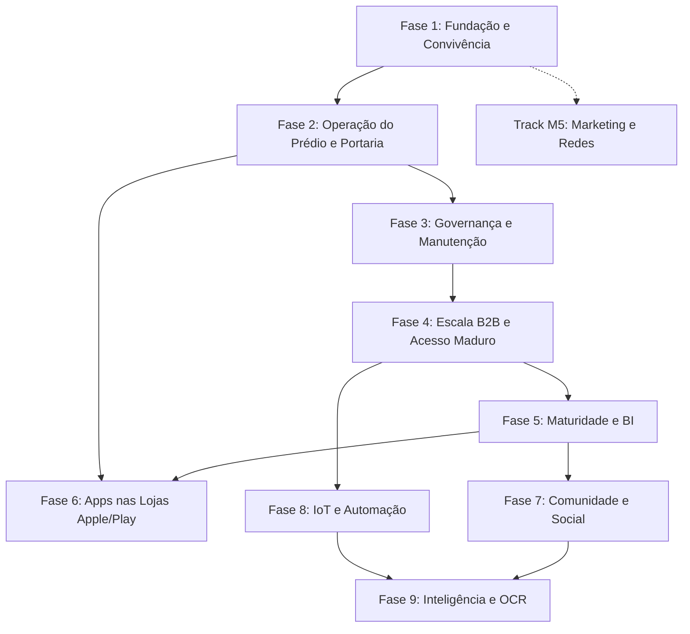

# Produto completo — catálogo de módulos por Bounded Contexts

Este documento descreve o **produto final** (visão de mercado e arquitetura), não um recorte mínimo. A entrega é **por fases**; cada fase adiciona módulos ou profundidade, sem reescrever a arquitetura.

## Princípio: produto completo, entrega incremental

| Conceito | Significado neste projeto |
|----------|---------------------------|
| Produto completo | Escopo, modelo de dados e arquitetura pensados para administradora multi-condomínio, financeiro, portaria, assembleias e hardware IoT |
| Fase | Conjunto **publicável** de valor (release utilizável), com módulos mapeados aos Bounded Contexts |
| Não-MVP descartável | Fase 1 já nasce com fundação sólida (multi-tenant RLS, RBAC, **9 Bounded Contexts**, auditoria); a infraestrutura **cresce em escada** (SQLite→Postgres, Redis, CDN). Fases ligam módulos, não descartam fundação |

---

## 1. Matriz de Correlação: 9 Bounded Contexts × 5 Pilares de Negócio

O código e as especificações seguem os **9 Bounded Contexts em pt-BR** ([ADR-013](../decisoes/ADR-013-organizacao-diretorios.md) e [Estrutura.md](../decisoes/Estrutura.md)). A navegação comercial de mercado correlaciona-se com os **5 Pilares de Negócio**:

| # | Bounded Context (`pt-BR`) | Funcionalidades Principais | Pilar de Negócio Correspondente | Fase Típica |
|---|---------------------------|----------------------------|---------------------------------|-------------|
| **1** | **`identidade_cadastro`** | Pessoas civis, contas de usuário, membros, unidades, veículos e animais domésticos | 1. Cadastro e Identidade | F1 (pessoas/unidades); F2 (veículos/pets) |
| **2** | **`condominio`** | Blocos, unidades, garagens, áreas comuns, branding e parâmetros operacionais | 3. Condomínio | F1 (blocos/unidades); F2 (áreas); F4 (branding) |
| **3** | **`controle_acesso`** ⭐ | Facial (Intelbras), credenciais RFID/QR/LPR, dispositivos, eventos e acionamentos | 2. Controle de Acesso ⭐ | F2 (facial/Intelbras/eventos); F4 (acionamentos) |
| **4** | **`portaria`** | Terminal da guarita, atendimento de visitantes, encomendas, mudanças e achados | 4. Experiência do Morador / 2. Acesso | F2 (visitantes/encomendas); F3 (mudanças/achados) |
| **5** | **`reservas`** | Espaços comuns, concorrência, lista de convidados para a portaria e vistorias | 4. Experiência do Morador / 3. Condomínio | F2 (agendamento/vistorias/convidados) |
| **6** | **`comunicacao`** | Mural de comunicados, livro de ocorrências, enquetes, mural social e Fale Conosco | 4. Experiência do Morador | F1 (comunicados/ocorrências); F2 (enquetes); F7 (social) |
| **7** | **`governanca`** | Assembleias virtuais (Lei 14.309), pautas, votos, atas e repositório normativo | 4. Experiência do Morador | F1 (documentos); F3 (assembleias/votações) |
| **8** | **`financeiro`** | Boletos, Pix instantâneo, conciliação bancária, prestação de contas e acordos | 5. Administração | F4 (gateway pós-P3; contabilidade externa antes) |
| **9** | **`manutencao`** | Chamados corretivos, ordens de serviço (OS zelador) e plano de preventiva (PMO) | 5. Administração / 4. Morador | F1 (ocorrências simples); F3 (OS/preventiva NBR 5674) |
| **10** | **`transversal`** | RBAC, auditoria pericial (`AuditLog`), catálogo SaaS de planos/entitlements e anti-DDoS | 5. Administração / Plataforma | F1 (RBAC/auditoria); F4 (planos/SaaS); F5 (MFA/BI) |

---

## 2. Catálogo Detalhado por Bounded Context

### 2.1. Identidade e Cadastro (`01_identidade_cadastro`)
Responsável pela modelagem civil, autenticação de contas, ocupação de unidades e patrimônio pessoal.
- **Onboarding e Conta:** Contas de acesso, autenticação JWT + Google OAuth 2.0, convites de membros e tenancy ([spec](../funcionalidades/01_identidade_cadastro/onboarding-e-conta.md)).
- **Solicitação de Cadastro:** Fila de auto-onboarding com envio de documentos e selfie para validação da gestão ([spec](../funcionalidades/01_identidade_cadastro/cadastro-morador-solicitacao.md)).
- **Veículos e Pets:** Cadastro de automóveis e motocicletas (placas vinculadas a vagas) e registro de animais de estimação ([spec](../funcionalidades/01_identidade_cadastro/veiculos-e-pets.md)).

### 2.2. Estrutura Física do Condomínio (`02_condominio`)
Representação cadastral do empreendimento físico e parâmetros institucionais.
- **Estrutura Física:** Mapeamento de blocos/torres, unidades residenciais, garagens e catálogo de áreas comuns ([spec](../funcionalidades/02_condominio/estrutura-fisica.md)).
- **Configuração Institucional:** Logotipo, cores do tema, horários de silêncio e normas de convivência ([spec](../funcionalidades/02_condominio/configuracao-condominio.md)).

### 2.3. Controle de Acesso e Hardware IoT (`03_controle_acesso` ⭐)
Diferencial tecnológico do produto com integração pericial de hardware e contingência offline.
- **Biometria Facial Intelbras:** Captura de templates faciais, integração via adapter `IntelbrasProvider`, sincronização assíncrona e operação offline ([spec](../funcionalidades/03_controle_acesso/biometria-facial-intelbras.md), [ADR-004](../decisoes/ADR-004-integracao-intelbras-facial.md)).
- **Credenciais e Dispositivos:** Gerenciamento de tags RFID, QR Codes dinâmicos com expiração e antenas LPR ([spec](../funcionalidades/03_controle_acesso/credenciais-e-dispositivos.md)).
- **Acionamentos e Eventos:** Abertura remota in-app com geofencing (Fase 4) e trilha pericial imutável de passagens ([spec](../funcionalidades/03_controle_acesso/acionamentos-e-eventos.md)).

### 2.4. Portaria e Atendimento (`04_portaria`)
Operação ágil da guarita humana ou remota em terminais touch/desktop.
- **Atendimento de Visitantes e Prestadores:** Validação ágil de convites QR, liberação espontânea e histórico de entradas ([spec](../funcionalidades/04_portaria/atendimento-visitantes-prestadores.md)).
- **Correspondências e Encomendas:** Registro fotográfico da etiqueta, push notification com PIN de retirada e baixa com assinatura ([spec](../funcionalidades/04_portaria/correspondencias-encomendas.md)).
- **Agendamento de Mudanças:** Calendário de uso do elevador de serviço, autorização prévia e vistorias de entrada/saída ([spec](../funcionalidades/04_portaria/agendamento-mudancas.md)).
- **Achados e Perdidos:** Mural digital de pertences esquecidos, custódia na guarita e termo de restituição ([spec](../funcionalidades/04_portaria/achados-e-perdidos.md)).
- **Rotinas de Portaria:** Passagem de serviço / troca de turno, controle de chaves de serviço e procedimentos de emergência (F2).

### 2.5. Reservas de Espaços Comuns (`05_reservas`)
Agendamento automatizado de áreas sociais com regras anti-conflito e vistorias patrimoniais.
- **Agendamento de Espaços:** Calendário interativo de churrasqueiras, salões e quadras, regras de antecedência e bloqueio por inadimplência ([spec](../funcionalidades/05_reservas/agendamento-espacos.md)).
- **Lista de Convidados:** Relação de convidados vinculada à reserva, sincronizada em tempo real com o terminal da portaria ([spec](../funcionalidades/05_reservas/lista-convidados.md)).
- **Vistorias Pré e Pós-Uso:** Checklist de patrimônio com fotos obrigatórias na entrega e devolução da chave ([spec](../funcionalidades/05_reservas/vistorias-checkin-checkout.md)).

### 2.6. Comunicação e Convivência (`06_comunicacao`)
Canais de engajamento oficial, transparência e registro civil de ocorrências.
- **Mural de Comunicados:** Avisos segmentados por bloco, comunicados urgentes e confirmação obrigatória de leitura ([spec](../funcionalidades/06_comunicacao/mural-comunicados.md)).
- **Livro de Ocorrências:** Livro digital unificado (`PORTARIA`, `MORADOR`, `GESTAO`), linha do tempo e controle de sigilo ([spec](../funcionalidades/06_comunicacao/ocorrencias-livro.md)).
- **Enquetes e Consultas:** Consultas públicas com regra estrita de um voto por unidade e apuração em tempo real ([spec](../funcionalidades/06_comunicacao/enquetes-consultas.md)).
- **Mural da Comunidade:** Classificados de desapego, doações e recomendações entre vizinhos com moderação ([spec](../funcionalidades/06_comunicacao/mural-comunidade.md)).
- **Canal Fale Conosco:** Mensageria direta e privada entre o morador e o síndico/administradora ([spec](../funcionalidades/06_comunicacao/canal-fale-conosco.md)).
- *Nota de escopo:* Não há suporte a chat em tempo real não moderado (decisão permanente F4).

### 2.7. Governança e Assembleias (`07_governanca`)
Cumprimento normativo da Lei 14.309/2022, deliberações oficiais e acervo documental.
- **Assembleias Virtuais e Híbridas:** Editais com convocação formal, procurações digitais, quórum qualificado por fração ideal, votações ao vivo e geração automática de ata ([spec](../funcionalidades/07_governanca/assembleias-virtuais.md)).
- **Repositório de Documentos:** Biblioteca digital da convenção, regimento interno, apólices de seguro, contratos de prestação e laudos técnicos ([spec](../funcionalidades/07_governanca/repositorio-documentos.md)).
- **Advertências Digitais:** Notificações de infração com fundamentação regimental e confirmação de ciência (F3).

### 2.8. Financeiro e Cobrança (`08_financeiro`)
Gestão orçamentária e arrecadação condominial. Na Fase 1 a 3 a operação financeira é externa na contabilidade (P3); a partir da Fase 4 o app incorpora integração direta:
- **Cobrança e Boletos:** Emissão de cotas condominiais, linha digitável, Pix dinâmico instantâneo com conciliação automática e 2ª via atualizada ([spec](../funcionalidades/08_financeiro/cobranca-e-boletos.md)).
- **Prestação de Contas e Balancetes:** Gráficos interativos de receitas/despesas, visualização de notas fiscais e emissão de parecer do conselho fiscal ([spec](../funcionalidades/08_financeiro/prestacao-contas-e-despesas.md)).
- **Acordos e Inadimplência:** Régua amigável de cobrança, simulação de parcelamentos e formalização de confissões de dívida ([spec](../funcionalidades/08_financeiro/acordos-e-inadimplencia.md)).

### 2.9. Manutenção Predial (`09_manutencao`)
Preservação física do condomínio e cumprimento estrito da norma ABNT NBR 5674.
- **Chamados e Ordens de Serviço (OS):** Abertura de chamados de reparo, triagem pelo síndico, encaminhamento ao zelador/prestador e encerramento com foto do serviço ([spec](../funcionalidades/09_manutencao/chamados-e-ordens-servico.md)).
- **Plano de Manutenção Obrigatória (PMO):** Cronograma automatizado de inspeções preventivas (gerador, bombas, extintores, para-raios e caixas d'água) ([spec](../funcionalidades/09_manutencao/manutencao-preventiva-pmo.md)).

### 2.10. Transversal e Plataforma (`10_transversal_plataforma`)
Camada de suporte arquitetural, segurança, licenciamento comercial SaaS e marketing.
- **Perfis e Permissões (RBAC):** Matriz canônica de papéis com guards no frontend e checagens no backend FastAPI ([spec](../funcionalidades/10_transversal_plataforma/perfis-e-permissoes.md)).
- **Central de Notificações:** Motor multicanal de disparo de Push PWA (VAPID), e-mails transacionais e alertas in-app ([spec](../funcionalidades/10_transversal_plataforma/central-notificacoes.md)).
- **Planos e Entitlements:** Catálogo comercial SaaS, regras de licenciamento de módulos e overrides por condomínio ([spec](../funcionalidades/10_transversal_plataforma/planos-e-entitlements.md), [ADR-011](../decisoes/ADR-011-planos-e-funcionalidades.md)).
- **Auditoria Pericial e Segurança:** Trilha imutável `evento_auditoria`, rate limit por token bucket (Redis) e mitigação anti-DDoS na borda ([13](13-seguranca-plataforma-logs-e-ddos.md)).
- **Marketing e Landing Page:** Portal público de apresentação comercial, FAQ compartilhado e captação de leads ([07](07-landing-page-marketing-e-conteudo-comum.md)).

---

## 3. Portais Especializados por Perfil

1. **Portal Morador (PWA Mobile-First):** Focado em autoatendimento ágil, comunicados, convites de visitantes, reservas de áreas comuns, chamados e 2ª via de boletos.
2. **Portal Portaria (Tablet / Desktop):** Interface com botões ampliados e alto contraste para atendimento expresso na recepção, liberação facial/QR e controle de encomendas.
3. **Portal Síndico e Conselho:** Painel gerencial para aprovação de cadastros, mural de comunicados, deliberações em assembleias, aprovação de contas e emissão de OS.
4. **Portal Administradora (Multi-Tenant B2B):** Gestão centralizada de múltiplos condomínios, parametrização comercial, suporte técnico e conciliação em lote.
5. **Portal Admin da Plataforma:** Gestão global de planos SaaS, faturamento de licenças, monitoramento de conectividade dos hardwares e segurança.

---

## 4. Fases de Entrega (Releases 1 a 9 + M5 GTM)

### Fase 1 — Fundação + Convivência Diária
- `transversal`: Monorepo, persistência SQLite→Postgres, auth JWT + Google, RBAC base, `evento_auditoria`, PWA shell e Fale Conosco.
- `identidade_cadastro`: Pessoas civis, contas de usuário, membros e ocupação de unidades residenciais.
- `condominio`: Estrutura física de blocos e unidades.
- `comunicacao`: Mural de comunicados oficiais com confirmação de leitura.
- `governanca`: Repositório de documentos normativos (convenção e regimento).
- `manutencao`: Livro simples de ocorrências.

### Fase 2 — Operação do Prédio
- `portaria`: Terminal da guarita, atendimento de visitantes, correspondências com foto e PIN, troca de turno e controle de chaves.
- `controle_acesso`: Credenciais dinâmicas, biometria facial com adapter **IntelbrasProvider** e eventos de passagem.
- `reservas`: Agendamento de espaços comuns, regras de concorrência, listas de convidados na portaria e vistorias com fotos.
- `comunicacao`: Enquetes rápidas da comunidade.
- `identidade_cadastro`: Cadastro de automóveis (vagas) e animais domésticos.

### Fase 3 — Governança e Operações
- `governanca`: Assembleias virtuais e híbridas (Lei 14.309), votações por fração ideal, procurações e atas digitais.
- `manutencao`: Chamados de manutenção, Ordens de Serviço (OS zelador), preventiva PMO (NBR 5674) e gestão de prestadores.
- `portaria`: Agendamento de mudanças com reserva de elevador de serviço e módulo de achados e perdidos.

### Fase 4 — Escala B2B + Acesso Maduro
- `financeiro`: Gateway de pagamentos integrado (boletos bancários e Pix dinâmico instantâneo pós-P3).
- `transversal`: Painel B2B para administradoras, catálogo SaaS com planos e entitlements ([ADR-011](../decisoes/ADR-011-planos-e-funcionalidades.md)) e personalização visual por condomínio (P5).
- `controle_acesso`: Acionamento remoto de portões in-app com geofencing, suporte a múltiplos provedores de hardware e integração com Smart Lockers.

### Fase 5 — Maturidade e Auditoria Avançada
- `transversal`: Autenticação multifator (MFA) para perfis administrativos, dashboards de BI e métricas de uso de API, PWA endurecido e integração com SIEM.

### Fase 6 — Aplicativos Nativos nas Lojas
- Publicação dos aplicativos empacotados via Capacitor na Apple App Store e Google Play Store ([12](12-publicacao-lojas-apple-play.md)).

### Fase 7 — Comunidade e Expansão Social
- `comunicacao`: Mural social da comunidade, classificados de desapego, indicação de prestadores locais e galeria de eventos.

### Fase 8 — Automação e IoT Avançado
- `controle_acesso` / `transversal`: Cenas de automação predial, telemetria de consumo individual (água/gás) e integração com câmeras IP.

### Fase 9 — Inteligência Assistida
- `transversal`: Assistente inteligente para busca semântica em atas/convenção, OCR de notas fiscais/etiquetas e moderação automática de conteúdos.

### Track Paralelo: Marketing / GTM (M0 a M5)
- **M0–M3:** Landing page institucional, documentação pública unificada de políticas e FAQ.
- **M5:** Presença oficial em redes sociais (Instagram, LinkedIn) rodando em paralelo à Fase 1.

---

## 5. Dependências entre Fases

---

## Status deste documento

| Campo | Valor |
|-------|-------|
| Status | `vivo` |
| Última revisão | 2026-10-17 — Reestruturação completa pelos 9 Bounded Contexts (ADR-013) e 26 specs |
