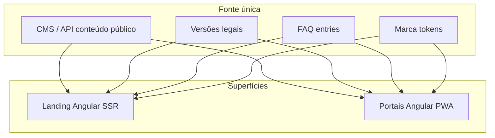

# Landing page (vendas) e conteúdo comum com o app

Site **público** para captar clientes (administradoras e síndicos), explicar o produto e converter (demo, contato, cadastro). Parte do conteúdo e das páginas legais **é compartilhada** com os portais logados do aplicativo.

---

## Objetivos

| Objetivo | Métrica (exemplo) |
|----------|-------------------|
| Explicar valor do produto | Tempo na página, scroll depth |
| Gerar leads | Formulário, WhatsApp, trial |
| Confiança / compliance | Políticas acessíveis, FAQ claro |
| SEO | Indexação de páginas institucionais |
| Suporte | FAQ reduz tickets repetidos no app |

---

## Ideias a partir dos concorrentes (set/2026)

Fonte: prints em [`../referencia/concorrentes/`](../referencia/concorrentes/). Posicionamento nosso: **gestão + acesso/facial** (nicho Condomínio Dedicado / Morador Online), não “só financeiro” (Superlógica/uCondo) nem “só acesso via revenda” (Condfy).

### Padrões que se repetem (e valem adotar)

| Padrão | Quem usa bem | Como aplicar aqui |
|--------|--------------|-------------------|
| **Headline curta + combo produto** | Residente (“Portaria, financeiro e app no mesmo sistema”), Seu Condomínio (“O condomínio inteiro. Num sistema só.”), Dedicado (gestão + acesso integrados) | Hero: **gestão + facial/acesso + app morador** numa frase — evitar lista longa |
| **CTA duplo no hero** | Residente, Wecondo, uCondo, Seu Condomínio | Primário: **Agendar demo / apresentação**; secundário: **WhatsApp** (ou “Como funciona”) |
| **WhatsApp flutuante + no header** | Quase todos | Botão fixo + link no nav; lead sem fricção (modelo consultivo do mercado) |
| **Mockup painel + celular** | uCondo, Condfy, Wecondo | Mostrar **painel síndico/portaria** + **app morador** (não só foto de pessoas) |
| **Chip de prova no hero** | Residente (“2 s · acesso por face”), uCondo (estrelas / N clientes) | 1 métrica ou benefício mensurável (ex. facial, unidades ativas) — sem strip de stats competindo com a marca |
| **Separar “já sou cliente”** | Seu Condomínio, Dedicado, Condfy | Link discreto: **Entrar no app** / área do morador ≠ CTA de vendas |
| **Seções por persona** | Wecondo, Condofy, Morador Online, uCondo | Blocos: síndico · portaria · morador · (depois) administradora |
| **FAQ agressivo na home** | Wecondo, Residente, Condfy, Seu Condomínio | 5–8 perguntas: preço, fidelidade, hardware facial, implantação, app morador |
| **Prova social** | TownSq, Condofy, Dedicado, uCondo | Depoimentos curtos + logos/números; preferir qualidade a “+2 milhões de lares” genérico |
| **Ângulo dor do síndico** | Condominizando, Wecondo | Copy emocional (“parar de apagar incêndio”) + solução concreta (acesso + rotina no app) |

### Ideias fortes por player (filtradas)

| Player | Pegar | Evitar / notar |
|--------|-------|----------------|
| **Residente Online** | Hero limpo; facial como prova visual; CTA demo + WhatsApp; tom “portaria + financeiro + app” | Não copiar verde; financeiro in-app só quando existir no roadmap |
| **Condomínio Dedicado** | Mensagem **gestão + controle de acesso**; CTA “agendar apresentação”; login por papel (morador / funcionário) | Laranja saturado full-bleed — diferenciar paleta (ver [paleta](../design/paleta-cores.md)) |
| **Morador Online** | Foco no morador; badge “plataforma”; WhatsApp orçamento; doc/FAQ | Gradiente roxo→teal + apps store no hero (fora do nosso look; lojas = secundário) |
| **Seu Condomínio** | “Um sistema, não seis integrações”; atalho **2ª via** no header (depois do financeiro); vídeo/demo | Chat widget pesado; lista enorme de módulos no primeiro viewport |
| **Wecondo** | Headline benefício (“você descansa”); mockups rotulados painel/app; FAQ síndico | Dark mode + glow — não é nosso default de design |
| **uCondo** | Prova por avaliações; dual CTA; mockup com IA só se for real | Roxo/indigo genérico de IA; exagero de métricas no hero |
| **Condfy** | Mockup laptop+celular de **portaria/acesso**; clareza de canal (revenda) | Copy “maior do Brasil” sem prova; público = integrador, não síndico |
| **Winker / Group / Superlógica** | Ecossistema / ERP (referência de maturidade) | Landing corporativa densa; pouco útil para M0 |
| **TownSq / MyCond / Condomob / Condofy** | Engajamento, demo, “para quem” | TownSq genérico demais; Condofy = administradora (outro negócio) |

### Estrutura sugerida da Home (M0 → M1)

Alinhada às regras de design do projeto (**1 composição no 1º viewport**: marca, 1 headline, 1 frase, 1 grupo de CTAs, 1 visual dominante — sem stats/cards no hero).

1. **Hero** — marca dominante · headline “gestão + acesso” · 1 frase · CTA demo + WhatsApp · visual full-bleed (app/mockup ou atmosfera do prédio, não collage)
2. **Para quem** — 3 colunas leves: síndico · portaria · morador (sem cards decorativos se der para ler sem borda)
3. **O que resolve** — 4–6 benefícios (facial/Intelbras, reservas, correspondências, visitantes/convites, comunicados, …) ligados ao [catálogo](06-produto-completo-modulos.md)
4. **Como funciona** — 3 passos (agendar → implantar → morador no app) — padrão Residente/Wecondo
5. **Prova** — 2–3 depoimentos ou números honestos
6. **FAQ** — compartilhado com o app (fonte única)
7. **CTA final** — formulário curto ou WhatsApp + link login

### Copy / ângulos candidatos (rascunho)

| Ângulo | Exemplo de headline |
|--------|---------------------|
| Integração | Gestão e controle de acesso no mesmo sistema |
| Dor | Menos WhatsApp solto. Mais rotina no app |
| Facial | Portaria com facial — e o condomínio no celular do morador |
| Unicidade | Um sistema — não um quebra-cabeça de integrações |

Escolher **um** ângulo no hero; os outros viram seções.

### Header / conversão (checklist)

- [ ] Logo + nav curta (Produto · Para quem · FAQ · Contato)
- [ ] CTA primário (Demo / Apresentação)
- [ ] WhatsApp
- [ ] Link **Entrar** (app) separado do CTA comercial
- [ ] Rodapé: legais + contato (fonte única com o app)
- [ ] Opcional M1+: atalho “2ª via” só quando boletos existirem

---

## Escopo da landing (páginas e seções)

### Páginas de conversão e institucional

- **Home** — hero (ver estrutura acima), benefícios, módulos (resumo), prova social, CTA (experimentar / falar com vendas)
- **Funcionalidades** — alinhado ao [catálogo](06-produto-completo-modulos.md) (por persona: morador, síndico, portaria, administradora)
- **Planos e preços** — tiers SaaS (quando definidos); comparativo — ver catálogo de modelos em [17](17-modelos-de-negocio-e-precificacao.md)
- **Para administradoras** / **Para síndicos** — landing secundárias (opcional, Fase marketing 2)
- **Contato / Demo** — formulário + integração CRM/e-mail (Celery)
- **Blog / Novidades** (opcional, fase posterior) — SEO e comunicação de releases

### Páginas legais e confiança (comuns com o app)

| Página | Uso na landing | Uso no app (logado) |
|--------|----------------|---------------------|
| Política de Privacidade | Rodapé, formulários | Rodapé, onboarding, LGPD |
| Termos de Uso | Cadastro trial / contrato | Aceite no primeiro login |
| Política de Cookies | Banner cookies (landing) | Banner se usar analytics no app |
| Termos do serviço SaaS (B2B) | Checkout / contrato administradora | Área administradora |
| FAQ | Seção + página dedicada | Ajuda in-app (mesmo conteúdo) |
| Central de ajuda / Suporte | Link público | Menu Ajuda |

**Regra:** uma **fonte única de verdade** por documento (versão + data de vigência); landing e app **consomem a mesma versão**, não duplicar texto em dois repositórios soltos.

### FAQ (conteúdo compartilhado)

Categorias sugeridas:

- Conta e acesso (morador, convite, recuperar senha)
- Planos, cobrança do **software** (SaaS)
- Privacidade e dados (LGPD)
- Funcionalidades por módulo (comunicados, boletos, portaria?)
- Suporte e contato

No app: mesma árvore de categorias; busca opcional (Fase 2 marketing).

---

## O que é comum entre landing e aplicativo



| Tipo | Compartilhamento | Implementação sugerida |
|------|------------------|-------------------------|
| Políticas legais | **100%** mesmo texto e versão | Backend: `LegalDocument` (slug, version, body_md, published_at); rotas públicas + link no app |
| FAQ | **100%** perguntas/respostas | Backend: `FaqCategory`, `FaqItem`; componente Angular em `packages/ui-help` |
| Marca (logo, cores, tipografia) | **100%** tokens | `packages/ui-brand` ou SCSS/CSS variables compartilhadas |
| Rodapé (links legais, contato) | **Componente** reutilizado | Biblioteca Angular compartilhada |
| Login / Cadastro | **Fluxo** — CTA na landing — URL do app auth | Mesmo domínio ou subdomínio (`app.` vs `www.`) |
| Comunicados de produto | Parcial | Landing: marketing; app: changelog in-app (pode espelhar API) |
| Preços | Landing principal; app admin vê contrato | API `public/plans` vs tenant billing |

### O que **não** misturar

- Analytics da landing (GA, pixels) vs analytics in-app (privacidade) — configurar por superfície, mesma política de cookies declarada.
- Conteúdo **por condomínio** (comunicados, documentos) — só no app tenant; landing só conteúdo **global da plataforma**.

---

## Arquitetura técnica (landing)

| Aspecto | Proposta |
|---------|----------|
| App | **`apps/web-marketing`** — Angular com **SSR/prerender** (SEO) ou hybrid |
| Domínio | `www.seudominio.com.br` (landing) + `app.seudominio.com.br` (portais) |
| API | Endpoints **públicos** read-only: `/api/v1/public/legal/{slug}`, `/api/v1/public/faq`, `/api/v1/public/plans` |
| Admin conteúdo | Django Admin ou tela **admin plataforma** para editar FAQ/legal (Fase 1 marketing ou paralela) |
| Formulários | POST lead — API — Celery (e-mail/CRM); rate limit + captcha |
| i18n | PT-BR primeiro; mesma base de tradução que app se expandir idioma |

Monorepo atualizado:

```
apps/
  web-marketing/    # Landing + páginas legais renderizadas (SSR)
  web-morador/
  web-portaria/
  web-admin/
packages/
  ui-brand/         # Logo, tema, rodapé legal
  ui-help/          # FAQ viewer, links políticas
services/
  api/              # Módulo public_content + leads
```

Alternativa válida: landing estática gerada no CI a partir do CMS — ainda assim **fonte única** no backend.

---

## Fases de entrega (marketing)

| Fase | Entregas |
|------|----------|
| **M0** (paralela à Fase 1 produto) | Home + contato; políticas v1 (privacidade, termos); FAQ mínimo; rodapé compartilhado no app |
| **M1** | Planos/preços, página funcionalidades, cookie banner, SEO (meta, sitemap) |
| **M2** | Blog opcional, A/B hero, integração CRM, FAQ busca |
| **M3** | Landings por persona, cases, material administradora |
| **M5 / GTM** | Perfis oficiais em redes sociais + calendário + links na landing (paralelo à F1+) |

A landing **não substitui** LGPD in-app (consentimento, exportação) — complementa com transparência pública.

---

## Backend — entidades de conteúdo (rascunho)

- `LegalDocument` — slug (`privacy`, `terms`, `cookies`, `saas-b2b`), version, locale, body (Markdown/HTML), effective_date
- `FaqCategory`, `FaqItem` — order, question, answer_md, visible_public, visible_in_app
- `MarketingLead` — name, email, phone, source, message, created_at
- `PublicPlan` — name, features_json, price_display (integrar billing depois)

Aceite de termos no app: gravar `UserTermsAcceptance(user_id, legal_document_id, version, accepted_at)`.

---

## Perguntas abertas (landing)

IDs **M1–M6** em [05-perguntas-abertas.md](05-perguntas-abertas.md) (pergunta permanece; resposta na coluna **Resposta**).

---

## Preview HTML (agora)

Protótipo estático: [`../../landing/`](../../landing/README.md) — abrir via hub ou http://127.0.0.1:8016/landing/

---

## Referências

- [06-produto-completo-modulos.md](06-produto-completo-modulos.md) — módulo SaaS / administradora
- [02-arquitetura-tecnica.md](02-arquitetura-tecnica.md) — monorepo e API
- [03-roadmap-e-entregas.md](03-roadmap-e-entregas.md) — marcos M0–M3, **M5** redes
- [14-revisao-plano-consolidada.md](14-revisao-plano-consolidada.md) — visão revisada das fases
- [17-modelos-de-negocio-e-precificacao.md](17-modelos-de-negocio-e-precificacao.md) — pricing / CTAs comerciais
- [../referencia/concorrentes/README.md](../referencia/concorrentes/README.md) — prints das landings concorrentes
- [../design/paleta-cores.md](../design/paleta-cores.md) — diferenciar do laranja Dedicado / roxo genérico

## Status deste documento

| Campo | Valor |
|-------|-------|
| Status | `vivo` |
| Última revisão | 2026-09-29 |
