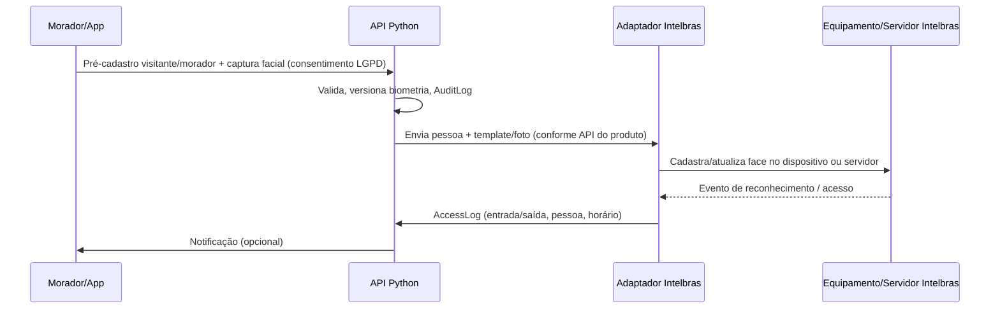

# Integração Intelbras — reconhecimento facial e liberação

Requisito de produto: **pré-cadastro de pessoas** com **reconhecimento facial** e **liberação de acesso** via integração com equipamentos/software **Intelbras**, em conjunto com o módulo de **portaria** e **reservas**.

Decisões relacionadas: **F3** (reservas Fase 2), **F5/F6** em [05-perguntas-abertas.md](05-perguntas-abertas.md), [ADR-004](../decisoes/ADR-004-integracao-intelbras-facial.md).

---

## Fluxo de valor (alvo)



---

## Casos de uso

| # | Caso | Ator | Resultado |
|---|------|------|-----------|
| 1 | Pré-cadastro de **morador/dependente** com face | Morador / síndico | Pessoa liberada para catracas/câmeras Intelbras do condomínio |
| 2 | Pré-cadastro de **visitante** (janela de validade) | Morador | Liberação temporária; face ou QR fallback |
| 3 | Liberação por **reconhecimento facial** na entrada | Equipamento | Acesso registrado no app (`AccessLog`) |
| 4 | Revogar acesso / expirar visitante | Morador / portaria | Remoção ou bloqueio no Intelbras |
| 5 | Reserva de área comum | Morador | Fluxo de reservas (F3); check-in portaria pode cruzar com acesso |

---

## Reservas (obrigatório)

- Módulo **Áreas comuns / Reservas** é **obrigatório** no produto (não opcional).
- Entrega: **Fase 2** (já decidido em F3).
- Escopo: espaços, regras, calendário, conflitos, cancelamento; taxa de uso **fora** do app enquanto financeiro for externo (P3).

---

## Arquitetura do adaptador e Bounded Contexts

Princípio: **domínio de controle de acesso no nosso backend**; equipamentos Intelbras isolados atrás da interface `AccessControlProvider`.
- Módulo facial e hardware pertencem ao Bounded Context **`controle_acesso`** ([spec](../funcionalidades/03_controle_acesso/biometria-facial-intelbras.md)).
- Módulo de reservas pertence ao Bounded Context **`reservas`** ([spec](../funcionalidades/05_reservas/agendamento-espacos.md)).
- Recepção e liberação de visitantes pertencem ao Bounded Context **`portaria`** ([spec](../funcionalidades/04_portaria/atendimento-visitantes-prestadores.md)).

```text
backend/app/modulos/controle_acesso/
├── dispositivos/
│   ├── adaptadores/
│   │   ├── base.py        # Interface abstrata AccessControlProvider
│   │   └── intelbras.py   # Implementação concreta Intelbras (API/SDK)
│   ├── models.py          # dispositivo_acesso, integracao_provedor
│   ├── schemas.py
│   └── service.py
├── credenciais/           # credencial_acesso, autorizacao_acesso, templates
└── eventos_acesso/        # evento_acesso (trilha pericial de passagens)
```

| Responsabilidade | Nosso sistema | Intelbras |
|------------------|---------------|-----------|
| Pré-cadastro, consentimento, validade | Sim | — |
| Armazenamento de política de acesso | Sim (fonte da verdade) | Espelho no dispositivo |
| Matching facial em tempo real | — | Equipamento/servidor |
| Eventos de passagem | Consome e audita | Emite |

**Fallback:** se integração offline, portaria libera manualmente / QR; fila Celery reprocessa sync.

---

## LGPD e biometria

Dados biométricos são **sensíveis** (LGPD Art. 5, II / tratamento específico):

- Consentimento explícito e destacado no pré-cadastro (C1 + política biométrica).
- Finalidade limitada: controle de acesso do condomínio.
- Retenção: apagar template ao revogar / sair da unidade / pedido de exclusão.
- Criptografia em trânsito e em repouso; acesso auditado.
- Menores (C2): consentimento do responsável.

Detalhar política em documento legal compartilhado (doc 07).

---

## Fases de entrega

| Fase | Escopo |
|------|--------|
| **2** | Reservas (obrigatório); portaria; pré-cadastro + liberação; **adaptador Intelbras** (piloto em 1 condomínio) |
| **2+** | Hardening multi-dispositivo, filas, monitoramento de sync |
| **4** | Outros fabricantes via mesma interface (se necessário); financeiro in-app continua separado (P3) |

---

## Sincronização e reconciliação

Aprovação cadastral **≠** sync com o equipamento ([ADR-009](../decisoes/ADR-009-idempotencia-integracoes.md)).

```text
PENDENTE → PROCESSANDO → CONCLUIDA
                       → FALHA → nova tentativa (backoff + limite)
```

Revogação de vínculo: encerrar autorização → revogar credencial → sync remoção no provedor.

Reconciliação periódica: comparar estado esperado × provedor (credencial faltante, autorização divergente, equipamento offline).

Segredos Intelbras: nunca no Git/código/log; secret store; rotacionáveis.

DDL: `sincronizacao_acesso`, `credencial_acesso`, `autorizacao_acesso` — [docs/sql/](../sql/README.md).

---

## Perguntas técnicas em aberto (IDs no arquivo 05)

Ver **I1–I4** e **F5–F6** em [05-perguntas-abertas.md](05-perguntas-abertas.md) (linha do produto, API, on-prem vs nuvem Intelbras, etc.).

---

## Status deste documento

| Campo | Valor |
|-------|-------|
| Status | `vivo` |
| Última revisão | 2026-10-17 — alinhamento a controle_acesso e reservas (ADR-013) |
